# 📦 Changelog

All notable changes to this project will be documented in this file.
This project adheres to [Keep a Changelog](https://keepachangelog.com/en/1.1.0/) and
[Semantic Versioning](https://semver.org/spec/v2.0.0.html).

Downloads for every version are on the [release page](https://github.com/fsegurai/arkenda-release/releases).

> **Legend** — 🧪 an experiment: off by default, turn it on per device in **Settings ▸ Experimental** ·
> 🧩 a built-in plugin: off by default, turn it on in **Settings ▸ Plugins** · 🖥️ desktop app only ·
> 📱 phone and tablet

---

## [Unreleased]

No changes have been made yet.

---

## [0.1.0] - 2026-xx-xx

  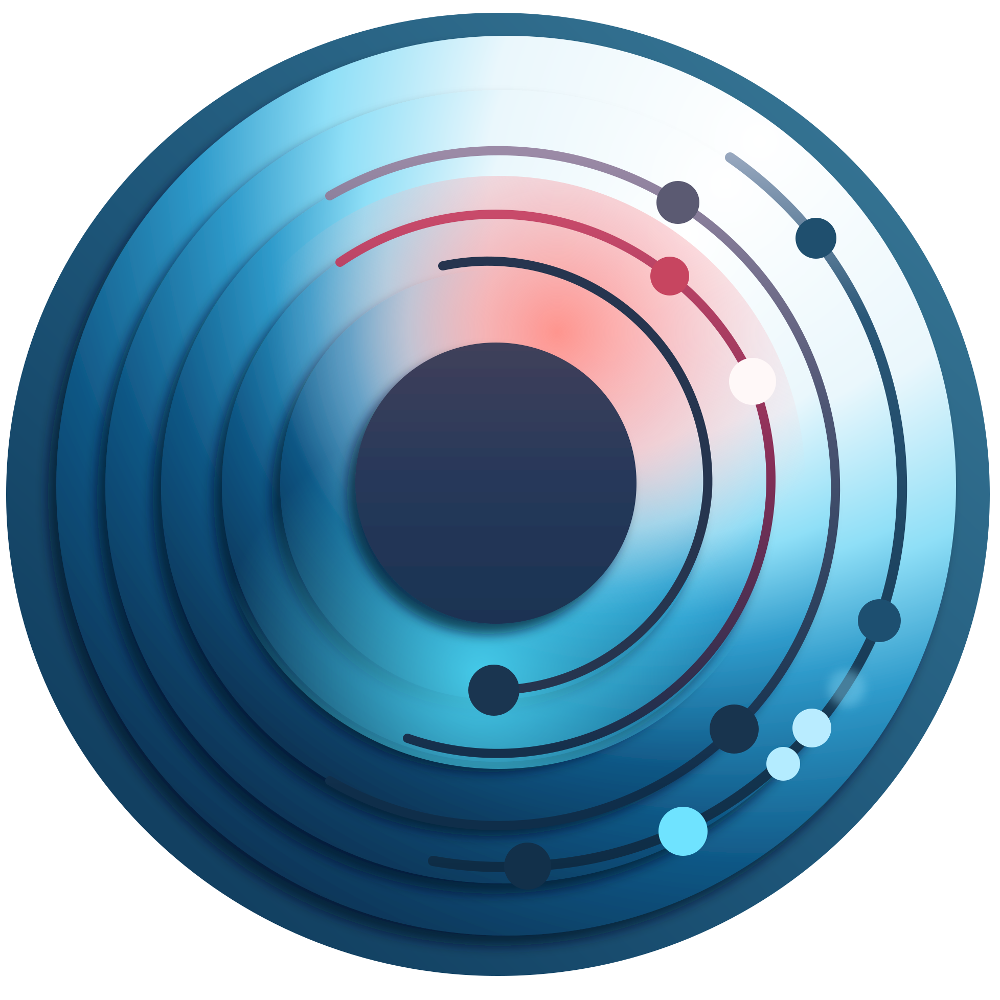

  <strong>The first release of Arkenda</strong> — a local-first, private Markdown notes app. 
  No account, no telemetry: your notes stay on your device as plain Markdown, and nothing reaches the network
  unless you turn on something that needs it.

  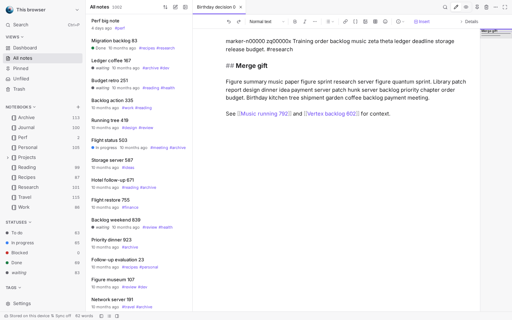

### ✨ Highlights

|                          |                                                                                      |
|--------------------------|--------------------------------------------------------------------------------------|
| 📝 **Markdown-first**    | Notes are portable Markdown with frontmatter, never locked in a database.            |
| 📂 **Your folder**       | On desktop a vault is a plain folder of `.md` files; edits made outside are picked up live. |
| 🔒 **Private sync**      | Device-to-device sync, end-to-end encrypted. Relays only ever see encrypted traffic. |
| 🧩 **Plugins**           | Sandboxed plugins with declared permissions: commands, panels, widgets, themes.      |
| 💻📱 **Everywhere**      | One app for the browser, the desktop (Linux, Windows) and phones and tablets.        |

---

### 🚀 Features

#### ✍️ Notes and editor

- **A Markdown editor with a toolbar** — headings, lists, links, tables, images and emoji; switch between edit and
  preview, with a minimap, find in note and "Turn into".
- **One insert menu** everywhere: type `/`, use the block `+` handle or the toolbar's **Insert**.
- **Linked notes** — `[[` suggests notes to link, `[[Note#Heading]]` jumps straight to a heading, and backlinks
  show who links here. `[!` suggests callouts, shown as coloured alerts.
- **Properties** — tags, status, pinned and the rest live in the note's frontmatter, explained in the
  **Details** panel.
- **Export a note** to share it outside Arkenda.
- **Live presence** — see who else is in a note, with their cursors, when a vault is shared between devices.
- 🧪 Richer Markdown blocks: tabs, timelines, spoilers, typographic quotes, Mermaid export, maps (`md-map`), and link
  titles fetched when a link is pasted.
- 🧪 Editor themes: a gallery of light and dark pairs.

#### 🗂️ Organise and find

- **Nested notebooks, tags and statuses** — set a status from any note, with counts in the sidebar.
- **Views** — Dashboard, All notes, Pinned, Unfiled and Trash, with a choice of note-list density.
- **Command palette** — one search for notes, `>` commands and `#` tags.
- **Outline** of the open note.
- 🧩 **Vault map** — your notes and their links as a 2D or 3D graph.

<table>
  <tr>
    <td width="50%">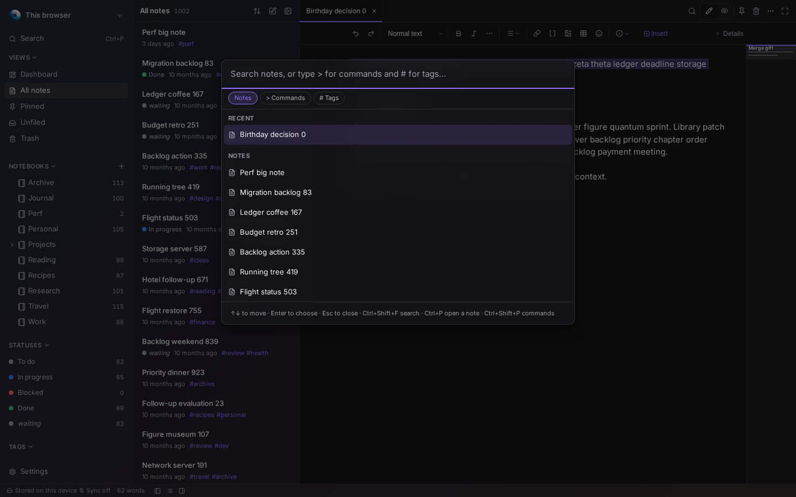</td>
    <td width="50%">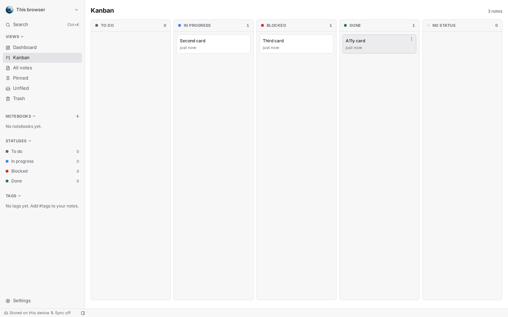</td>
  </tr>
  <tr>
    <td align="center">The command palette (dark theme)</td>
    <td align="center">Kanban: notes in their status lanes</td>
  </tr>
</table>

#### 📅 Plan your day

- 🧪 **Today** — overdue and upcoming tasks in one place, with quick add.
- 🧪 **Todos and calendar** — every task across your notes, by date.
- 🧪 **Kanban** — notes grouped by status, with an *Unassigned* lane; move cards by dragging, with `Alt+arrow` or from
  a menu.
- 🧪 **Whiteboards** — shapes, text, sticky notes, connectors, images and live note cards; drop files from your file
  manager onto the board. Each board is saved as a note.
- 🧩 **Dashboard widgets** — pomodoro, insights, weather and clock.

#### 🖼️ Media and attachments

- **Audio and video** play right in the note; any other file shows as a card with **Open** and **Save**.
- **Pictures** — annotate and redact, compression levels, and location data (EXIF) removed on import.
- **PDF reader** — read PDFs in the app and link to a highlighted passage.
- **Media library** — filter by type, sort into folders with labels, and delete safely (a trash per device, by kind).
- **Attachment folders** — give a notebook a media folder: new uploads go there, and moving a note offers to move its
  media too.
- 📱 Capture photos, audio and video from the phone or tablet.

  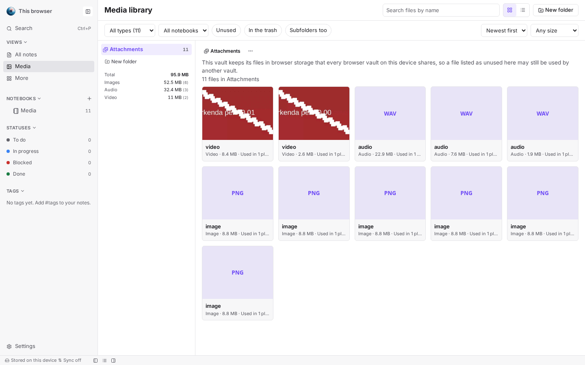

#### 💾 Vaults and storage

- **Browser vault** — stored in the browser (IndexedDB) and exported to a portable archive whenever you want.
- 🖥️ **Folder vaults** — a vault is a folder: folder = notebook, file name = title. See
  the folder vault guide.
- **Several vaults** — a vault picker and **Manage vaults**; a vault that is not reachable is shown as such, never
  lost.
- **Backups** — import and export run in the background, and imports are checked before anything is written.
- **Cloud mirror (S3)** — a copy in your own bucket, encrypted with a recovery code when you choose, and the option to
  keep large media only there.

#### 🔄 Sync and devices

- **End-to-end encrypted sync** between your paired devices — see the sync guide.
- **Pair with a code**, step by step; paired devices find each other again on the local network.
- **Every way to connect, in order** — the local network, across networks (desktop and Android), public relays, and
  store-and-forward through your own S3 mirror.
- **Sync & devices** — the status at a glance, each device's health, a connection test and *what syncs where*.
- **Large media waits for Wi-Fi**, with a switch per device.

<table>
  <tr>
    <td width="50%">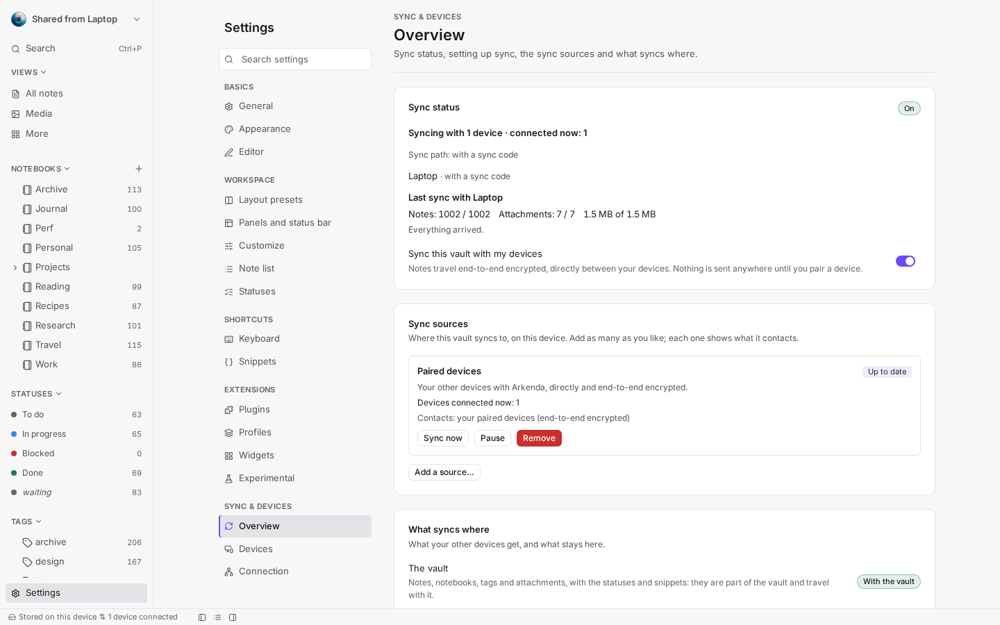</td>
    <td width="50%">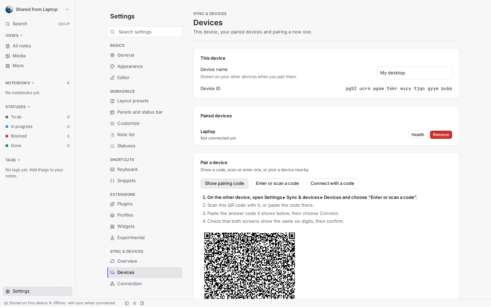</td>
  </tr>
  <tr>
    <td align="center">Sync &amp; devices at a glance</td>
    <td align="center">Pairing a new device with a code</td>
  </tr>
</table>

#### 🧩 Plugins

- **Sandboxed plugins** with declared permissions: they add commands, insert items, panels, widgets, settings, themes
  and Markdown blocks — and never reach the app's pages, cookies, storage or secrets.
- **Built-in plugins** (🧩 all off by default): pomodoro, insights, vault map, git history, weather and clock.
- **Write your own** — plugin documentation, from getting started to permissions and
  testing.

#### 🖥️ Desktop app

- **A flexible layout** — collapsible panes with an icon rail, a toolbar row, a selection bar, and notes side by
  side in horizontal and vertical splits. See the desktop layout guide.
- **The activity island** — quick capture with a global key, screenshots, voice memos and a drop shelf. See
  the island guide.
- 🧩 **Version history with git** — the vault's history through your system's git.
- **Secrets in the OS keychain.**
- **Check for updates** in **Settings ▸ About**, which asks the release page only when you click.
- 🧪 Glass window effect (Linux notes), a system-wide notch, screen recording, an
  integrated terminal and a local MCP server.

  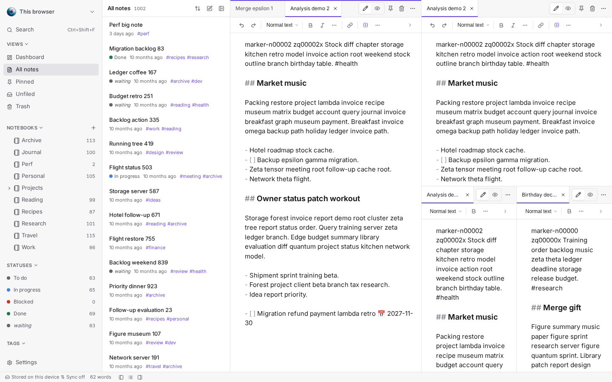

#### 📱 Phone and tablet

- **Made for touch** — a bottom bar (Notes, Today, Search, More), a **+** button, long-press sheets, row swipes,
  pull to sync and the system back gesture.
- **Writing on a phone** — a single compact header, the formatting bar above the keyboard, and details as sheets;
  new notes open ready to type.
- **Tablets** — drawers in portrait, two panes with a rail in landscape. See
  the phone and tablet guide.

<table>
  <tr>
    <td width="50%" align="center">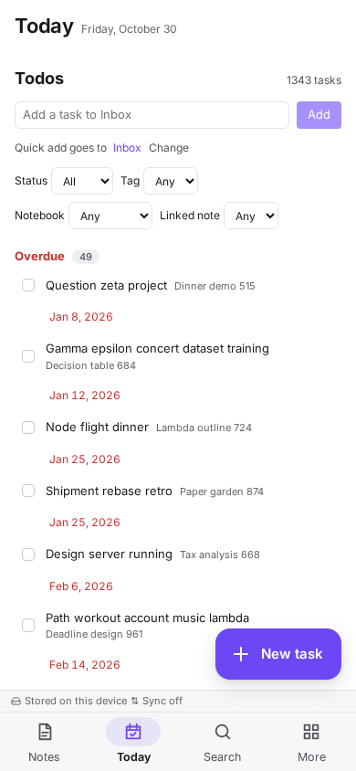</td>
    <td width="50%" align="center">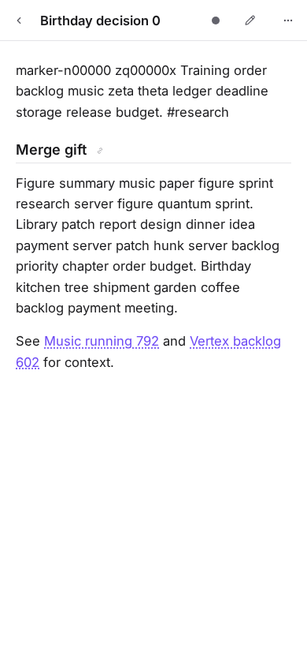</td>
  </tr>
  <tr>
    <td align="center">Today, with the bottom bar</td>
    <td align="center">Reading a note</td>
  </tr>
</table>

#### 🎨 Settings, themes and languages

- **A new Settings** — two columns on desktop, stacked pages on touch, with dedicated *Sync & devices* and
  *Data & storage* pages and a tidy *Experimental* page.
- **Themes and accents** — presets such as Nord, Sepia and High contrast, and accent colours.
- **Your shortcuts** — customise keyboard shortcuts and snippets. See keyboard shortcuts.
- **English and Spanish** (en-US, es-CR).

<table>
  <tr>
    <td width="50%">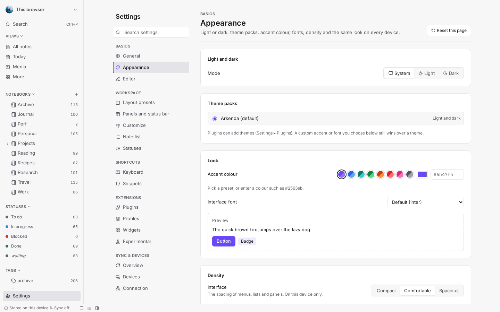</td>
    <td width="50%">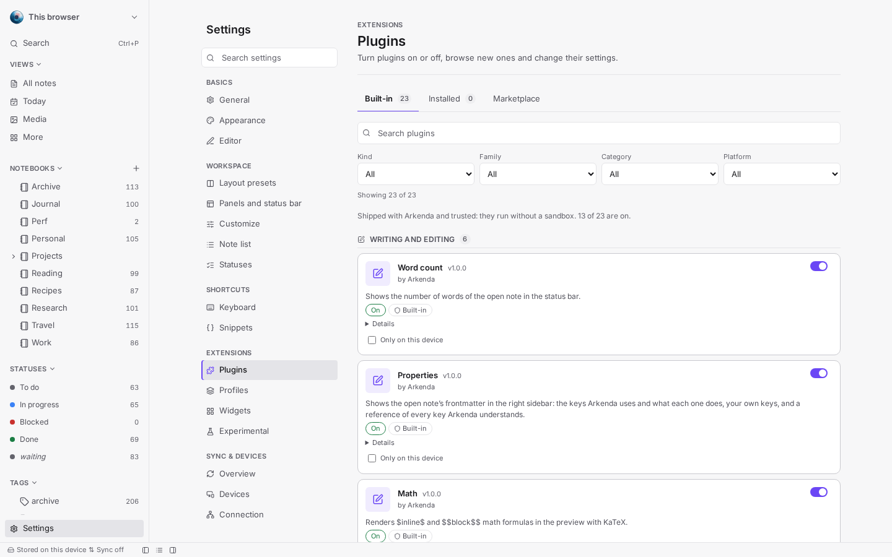</td>
  </tr>
  <tr>
    <td align="center">Appearance</td>
    <td align="center">Plugins</td>
  </tr>
</table>

### 🔐 Security

- **Private by default** — no account and no telemetry; a strict Content Security Policy names every host the app may
  contact, and it is checked on every build.
- **Encrypted sync** — relays only pass on encrypted traffic they cannot read; a cloud mirror is encrypted too when you
  turn on its **Encrypted** switch (with a recovery code).
- **Every input is checked** — imports, sync messages and plugin calls are validated before they touch your data.
- **Plugins in a sandbox**, limited to the permissions you grant.

### ⚡ Performance

- **Fast start** — the startup bundle is kept under a hard budget on every build (web, desktop and mobile); features
  you have not opened load only when you need them.
- **Large vaults** — measured with 10,000-note vaults; the todo list opens about twice as fast as in earlier builds.

### 📝 Documentation

- Guides for folder vaults, sync, media,
  keyboard shortcuts, the desktop layout,
  phones and tablets, the activity island and
  plugins.

---

### ✅ Compatibility

| Platform                | Status in 0.1.0                                                                    |
|-------------------------|------------------------------------------------------------------------------------|
| 🌐 Web                  | ✅ Modern browsers; the vault lives in the browser's storage                        |
| 🐧 Linux                | ✅ `.deb`, `.rpm` and `.AppImage`                                                  |
| 🪟 Windows              | 🟡 `.msi` and setup `.exe`, built automatically; not yet tried on a Windows machine |
| 🤖 Android              | ✅ `.apk` for arm64 (Android 7 or later), installed from the release page            |
| 🍎 macOS and iOS        | ⏸️ On hold                                                                         |

<strong>Known limitations</strong>

- The installers are **not code-signed** yet: Windows SmartScreen may warn the first time you open the app.
- **No automatic updates** yet — **Check for updates** tells you when a new version is out and links to it.
- Printing a note on macOS and on Android is not available yet.
- Features marked 🧪 are experiments: they may change, and they stay off until you turn them on.

[unreleased]: https://github.com/fsegurai/arkenda-release/releases

[0.1.0]: https://github.com/fsegurai/arkenda-release/releases/tag/v0.1.0
