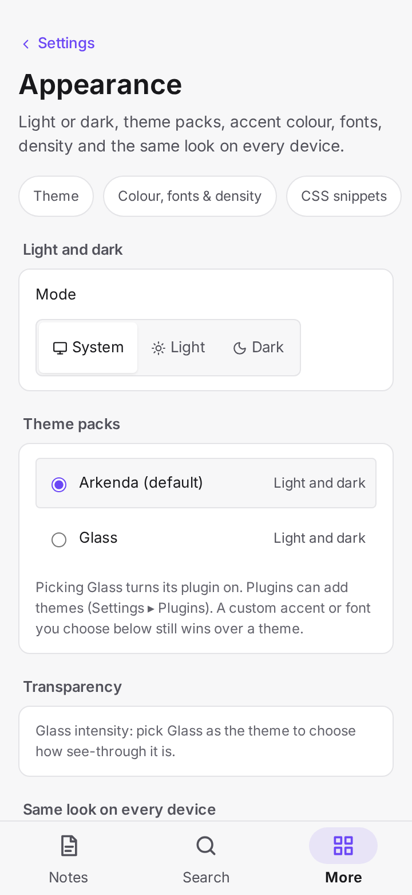
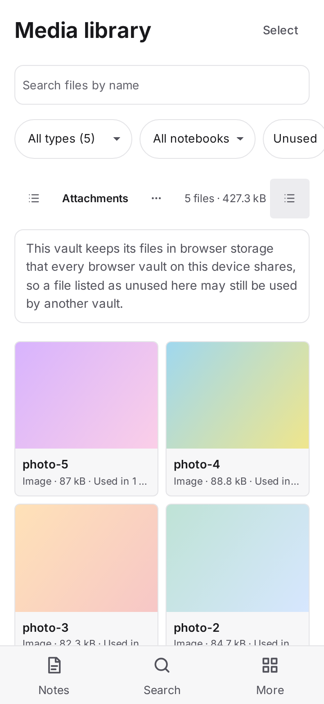
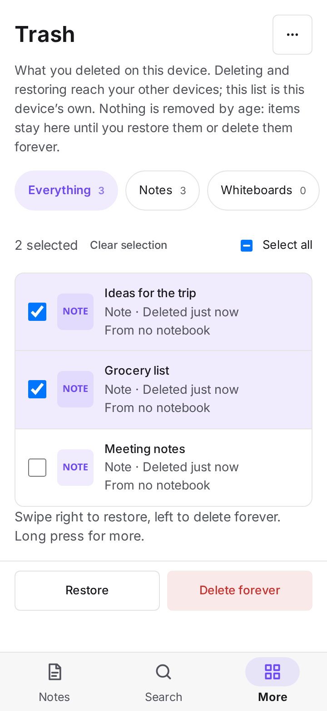
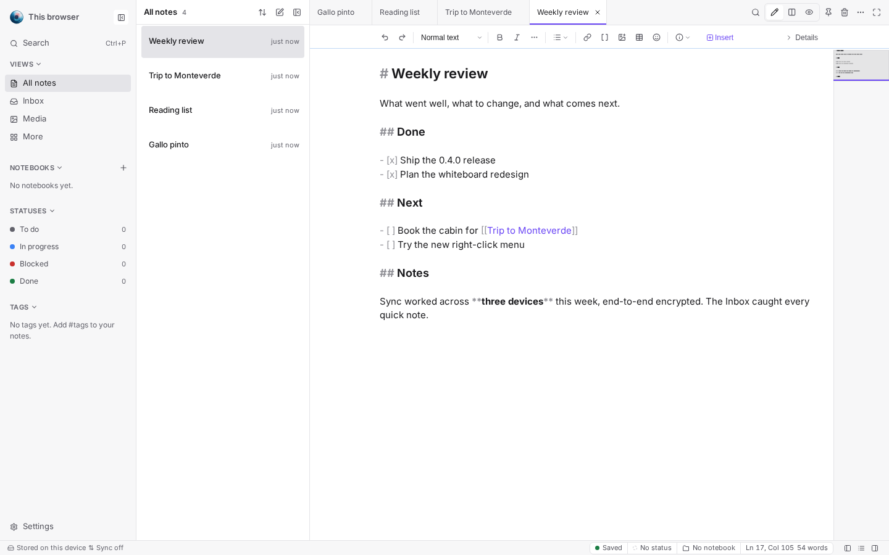
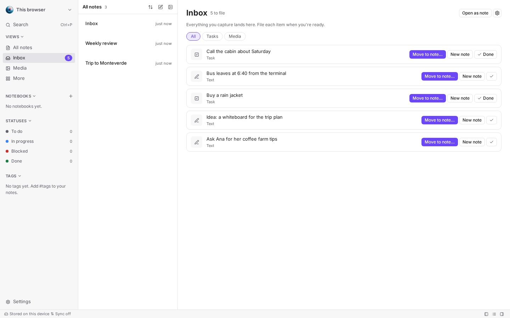
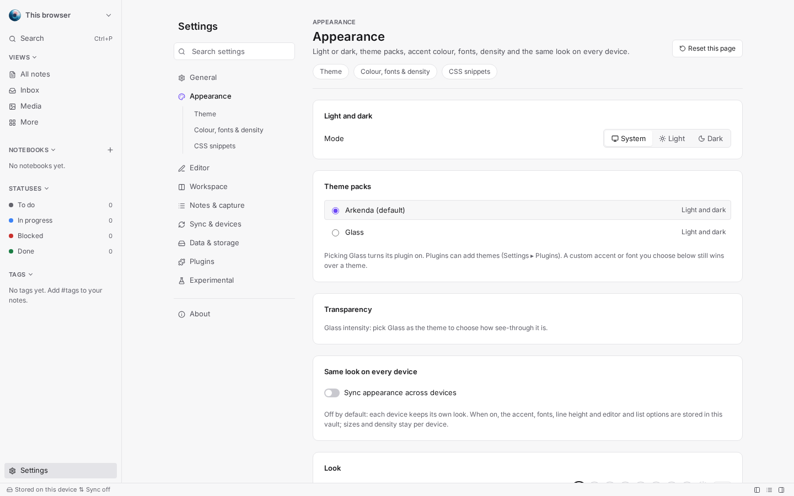
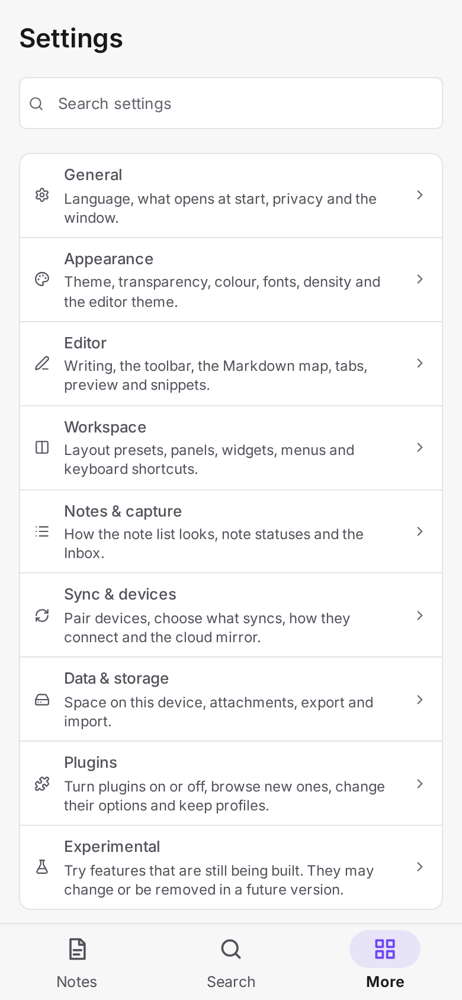
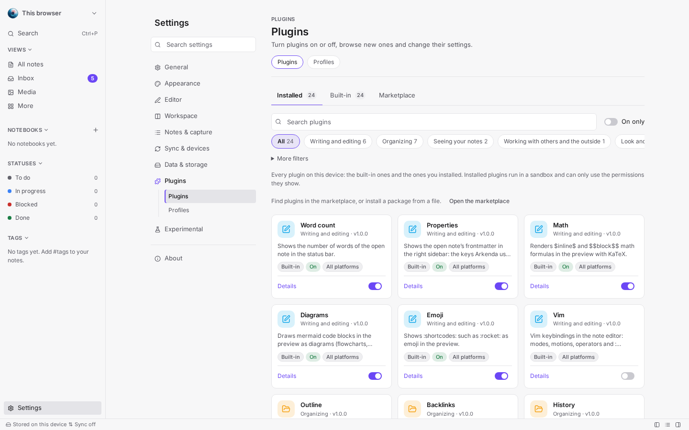
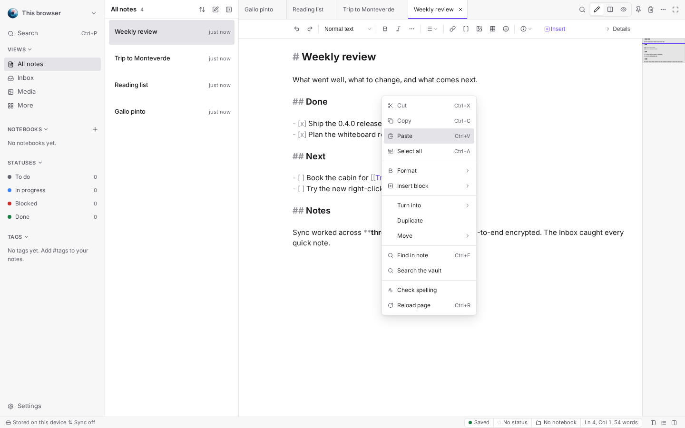
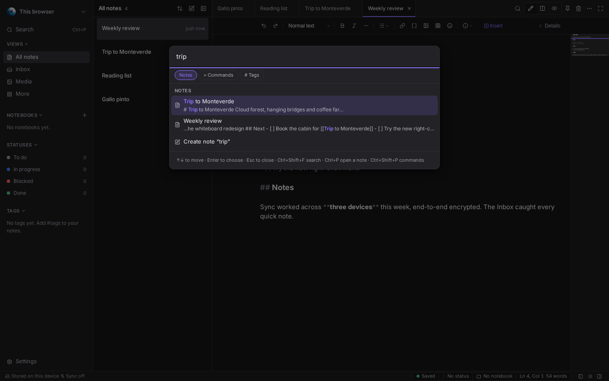

# 📦 Changelog

All notable changes to this project will be documented in this file.
This project adheres to [Keep a Changelog](https://keepachangelog.com/en/1.1.0/) and
[Semantic Versioning](https://semver.org/spec/v2.0.0.html).

Downloads for every version are on the [release page](https://github.com/fsegurai/arkenda-release/releases).

> **Legend** — 🧪 an experiment: off by default, turn it on per device in **Settings ▸ Experimental** ·
> 🧩 a built-in plugin: off by default, turn it on in **Settings ▸ Plugins** · 🖥️ desktop app only ·
> 📱 phone and tablet

---

## [Unreleased]

No changes have been made yet.

---

## [0.4.1] - 2026-11-12

Roomier, tidier pages on phones, pasting that works again in the Linux app, videos that play in the Linux
AppImage, and a trash that really deletes on phones.

<table>
  <tr>
    <td width="33%" align="center"></td>
    <td width="33%" align="center"></td>
    <td width="33%" align="center"></td>
  </tr>
  <tr>
    <td align="center">Settings</td>
    <td align="center">Media library</td>
    <td align="center">Trash</td>
  </tr>
</table>

### 🔧 Changes

- 📱 **Phone pages** — Settings, the media library, the trash, More, Today, Inbox, Todos, Calendar, Dashboard,
  Board, Whiteboards and Vaults share one layout on phones: the same margins, the title with at most one button
  beside it, tabs and filters in one row you swipe sideways, and each card's title above the card. Computers and
  tablets look as before.
- 📱 **Trash** — **Empty trash** is in the **⋯** menu at the top; with items selected, **Restore** and
  **Delete forever** stay at the bottom of the screen.
- 📱 **Settings** — **Reset this page** is at the end of the page.
- 📱 **Inbox** opens as its own page on phones instead of the note list.

### 🐛 Fixes

- 🖥️ **Paste on Linux** — the right-click menu's **Paste**, and pasting a screenshot with Ctrl+V, work again in the
  Linux app ("The app is not allowed to read the clipboard" is gone).
- 🖥️ **Videos in the Linux AppImage** — adding a large video no longer freezes the AppImage or turns its window
  black, and YouTube cards play; the AppImage now carries the media plugins it needs on every distribution.
- 📱 **Delete forever on phones** — **Empty trash** and **Delete forever** no longer bring deleted files back into
  the media library. On a phone or in a browser, a file other vaults on the device may share stays stored, but it no
  longer shows in the library unless a note uses it again.

---

## [0.4.0] - 2026-11-11

A redesigned Settings, an Inbox that files your captures, a richer right-click menu with spelling suggestions,
a cleaner Markdown map, Arkenda in the Microsoft Store, and phones that save battery when Arkenda is in the
background.

  

### ✨ New

- **Inbox** — one Inbox note per vault, with its own page to file what you capture: move a line to a note, turn it
  into a new note, or mark it done. Images, videos and files show what they are, with their name and a thumbnail.
  Choose the Inbox note and what filing does in **Settings ▸ Notes & capture ▸ Capture**.

  

- **Redesigned Settings** — every option grouped into nine categories, with the less common ones folded under
  **Advanced**, one search that also finds plugins and experiments, an icon rail on tablets and category screens
  on phones.
- **Plugins and Experimental as grids** — filter by family or area, search, show only what is on, and open a
  plugin's options in a sheet.

  <table>
    <tr>
      <td width="62%"></td>
      <td width="38%" align="center"></td>
    </tr>
    <tr>
      <td align="center">The categories and one search on the desktop</td>
      <td align="center">One screen per category on phones</td>
    </tr>
    <tr>
      <td colspan="2"></td>
    </tr>
    <tr>
      <td colspan="2" align="center">Plugins as a grid: families, search and On only</td>
    </tr>
  </table>
- **Media library preview** — each file previews by its kind: images whole, video and audio that play in place
  (audio with its waveform), a PDF's first page and page count, a text file's first lines.
- 🧪 **Right-click menu** — back and forward, reload (it saves your edits first), zoom, settings, and in the editor
  **Check spelling**; 🖥️ on Linux and Windows the misspelled word's suggestions appear at the top of the menu. On by
  default; turn it off in **Settings ▸ Experimental**.

  <table>
    <tr>
      <td width="50%"></td>
      <td width="50%"></td>
    </tr>
    <tr>
      <td align="center">The editor's right-click menu</td>
      <td align="center">Ctrl+P finds notes, commands and tags</td>
    </tr>
  </table>
- **Ctrl+Tab order** — in **Settings ▸ Editor ▸ Tabs**, keep the strip order (Linear) or switch to the most recent
  tabs (Recent): hold Ctrl and press Tab to walk back, release to land.
- **Keys** — Alt+← / Alt+→ go back and forward, Ctrl+R (⌘R) reloads after saving.
- 🖥️ **Microsoft Store** — Arkenda can be installed from the Microsoft Store, signed by Microsoft and updated by
  the Store. The direct installers stay available as before.
- 📱 **Save battery** — when Arkenda goes to the background on a phone, sync pauses and catches up as soon as you
  return. Turn it off in **Settings ▸ Sync & devices ▸ Connection ▸ Battery** to keep syncing in the background.

### 🔧 Changes

- **Markdown map** — shows your note's text from far away, one stroke per word, instead of a small blurry render;
  the heading under the pointer shows as a tip.
- **Glass theme** — picking Glass turns it on in one step; choose **Subtle** or **Strong** (today's look), and find
  Reduce transparency and the window blur together under **Transparency**.
- 🖥️ **Window effect** — the **Translucent** mode was removed (a see-through window looked bad on Linux and
  Windows); **Blur** stays as it was. A device that used Translucent now opens with the effect off.
- 📱 **Phone settings** — phones no longer show settings that don't apply to them (toolbar, tabs, reading width,
  layout presets, panels and widgets).
- **Inline code** stands out from the text, in the editor and the preview.
- **Video cards in lists** — a YouTube or X link alone in a list item now shows as a card too.
- **Sync messages** — clearer reasons when a device can't be reached, and which backups each device has.
- 🖥️ **Windows installers** show Arkenda's icon and branding.

### 🐛 Fixes

- 🖥️ **YouTube cards on desktop** — videos play instead of showing "Error 153".
- **Pasting screenshots** — images copied from a screenshot tool paste into the editor.
- **Pinned notes** — pinning from the editor always shows in the note list (folder vaults).
- 🖥️ **Title bar** — the app no longer slides up behind Arkenda's title bar.
- 🖥️ **Middle-click on a tab** (Linux) — closes the tab without pasting into the note.
- **Reduce transparency** shows only where it applies.
- 📱 **Phone screens** — the image viewer and annotator clear the status bar, and links open in your browser.
- **Search after a hiccup** — if search's background helper restarts and your notes can't be read right away,
  search keeps retrying in the background and catches up without waiting for you to edit a note.

### ⚡ Performance

- **Less memory in large vaults** — each note's searchable text is kept once instead of twice (about 20% less
  memory with 10,000 notes), and the editor remembers the cursor and scroll position of up to 200 notes per pane.
- 🖥️ **Faster desktop start** — less code loads before the window appears.

### 📝 Documentation

- A [privacy policy](PRIVACY.md) and issue forms for bugs, features, questions and other feedback.
- The [README](README.md) shows the 0.4.0 screens and features: the Inbox, tabs, the Glass theme, the new Settings
  paths and in-app updates.

---

## [0.3.1] - 2026-11-09

Syncing media to the Linux desktop app works again, and large notes and files sync reliably on every device.

### 🐛 Fixes

- 🖥️ **Linux app froze and went blank while syncing media** — the Linux desktop app no longer stops responding,
  goes blank and needs a force quit when photos, videos or other large files sync from a phone or another device.
  Sync now sends them in pieces small enough for the Linux app to sign safely.
- **Large notes in the S3 mirror** — very large notes and big changes are now split into smaller pieces when they
  go to the S3 mirror, so they upload from every device, the Linux app included.
- **Plugin signatures** — the plugin catalog and plugin releases with large signed files are verified correctly on
  the Linux app.
- 🖥️ **Slow sync after a connection hiccup** — if the desktop app's connection between its window and the system
  drops to its slow fallback, the app now notices and offers to restart, which brings full speed back.

### ⚡ Performance

- **Receiving media** — each piece of a received photo, video or file is checked once instead of twice, so large
  files arrive faster and use less memory.

---

## [0.3.0] - 2026-11-09

Note properties you can see and edit, a note list that fits any width, a richer History, Linux
that matches Windows (native blur, the system accent, the desktop's window buttons), more ways to make the app
yours, X and YouTube cards, a much fuller MCP for AI agents, and in-app updates on Android.

### ✨ New

- **Note properties** — the **Properties** panel shows a note's properties and lets you add, edit, rename and
  remove them (text, number, date, checkbox, list, tags). A folder vault keeps them in the note's frontmatter, changed
  without touching anything else in the file; a browser vault keeps each property apart, so edits made on two
  devices at once both survive.
- **A note list that fits** — no more sideways scrolling: long titles, tags and notebooks fit any width, the time
  sits on the title line, a coloured edge shows the status, two tags show with "+N", the notebook path shows in
  mixed views, pinned notes get their own **Pinned** section, and the desktop shows quick actions on hover.
- **Status bar note strip** — the status bar shows the open note's save and sync state, status, notebook,
  backlinks, the caret position and word count, each one clickable.
- **History** — versions are grouped by day with how much each one changed; compare in the panel, at full width
  or in a tab of its own (**Open in a tab**); restore only the lines you pick; **Undo** after any restore; name a
  version ("Before the rewrite") and filter by source or by name. The text a restore replaces is always kept as a
  version first.
- 🖥️ **Native blur on Linux** — with **Window effect ▸ Blur**, KDE Plasma (Wayland and X11) blurs what is behind
  the window; desktops that blur by their own rules, or offer apps no blur (GNOME), say so instead.
- **System accent colour** — **Appearance ▸ Accent ▸ System** follows the accent colour of Windows, of your Linux
  desktop, or of the browser where it offers one, and changes with it. On Linux the system's light or dark choice
  is also read from the desktop.
- 🖥️ **Window buttons where your desktop puts them** — with Arkenda's own title bar on Linux, the minimize,
  maximize and close buttons follow your desktop's layout (left or right, and which ones).
- **Notebook colours and icons** — give a notebook a colour and an emoji from its menu (**Colour and icon…**);
  they show in the sidebar, the note list, the status bar and the tabs. A folder vault keeps them in
  `.arkenda/notebooks.json`, so they travel with the vault.
- 🖥️ **Interface zoom** — make the whole window larger or smaller (80–150 %) in **Settings ▸ Appearance** or with
  Ctrl/Cmd + and −, Ctrl/Cmd 0 to reset; kept per device. Also the fix for Linux scaling that draws the app too
  small or too large.
- **Focus writing** — in zen mode, keep the line you type in the middle of the editor and dim the other
  paragraphs (two switches in **Settings ▸ Editor**).
- **CSS snippets** — your own small style sheets in **Settings ▸ Appearance ▸ CSS snippets**, kept on this device,
  each turned on or off. If the app fails to start with snippets on, the next start runs without them and tells
  you which; Ctrl/Cmd+Alt+Shift+S turns them all off for the rest of a run. Stable hooks:
  [docs/css-snippets.md](docs/css-snippets.md).
- **Glass theme** — a built-in theme pack, light and dark: see-through side panels and bars over an aurora in
  your accent colour (or your desktop, with the window effect's blur), text kept readable.
- **Reduce transparency** — a switch in **Settings ▸ Appearance** makes Glass, the window effect and frosted menus
  solid on this device; on Android, battery saver does the same for Glass.
- 🧪 **X and YouTube cards** — a YouTube video or a post on X linked alone on its line shows as a card in the
  preview; nothing from YouTube or X loads until you click it, then it plays in a sandboxed frame from
  `youtube-nocookie.com` or X's embed page. The desktop and Android apps show the thumbnail, title and author; on
  the web, YouTube cards do so only after you turn on **Show previews on the web**. The note keeps the plain link.
- 📱 **Update from About on Android** — **Settings ▸ About** downloads a new version, checks its signature and that
  it is signed like the installed app, and opens Android's installer (allow **Install unknown apps** for Arkenda
  once). Versions before 0.3.0 still link to the release page: the first in-app update is the one after 0.3.0.
- **MCP for AI agents** — the local MCP server can now append to a note, insert under a heading and replace text;
  set properties, tags, the pin and the status; add, check and date tasks; list notebooks, tags and the trash;
  move and restore notes; list notes and images as resources (with change notices); and offers prompts
  (summarize a note, a daily review, related notes). Every write still asks you first. Agents set up for 0.2.x
  keep working.

### 🔧 Changes

- **Linux downloads** — the `.deb` and `.rpm` are now the recommended Linux downloads: about as small as the
  Windows installer (the `.AppImage` carries its own WebKitGTK and is several times larger). All three update
  themselves.

### 🐛 Fixes

- **Note properties showed nothing** — properties are now read and shown for every note, and what you add is
  kept.
- **MCP server** — the launcher's arguments, the token file's permissions, idle HTTP sessions (closed after 90 s)
  and an empty search are handled; a regenerated token reaches the running server.

---

## [0.2.0] - 2026-11-07

In-app updates on the desktop, PDF export on Android, `.mkv` videos, a faster start for large vaults, internal
links that open, menus that look alike everywhere, and an experimental browser window. It includes the betas
`0.2.0-beta.0` (2026-11-06) and `0.2.0-beta.1`.

### ✨ New

- 🖥️ **Update from About** — **Settings ▸ About** downloads a new version, checks its signature and installs it
  with **Restart now**, once every window has saved its edits, on Windows and Linux. Versions from 0.1.x still show the new version with a link to the release page: the first
  in-app update is the one after 0.2.0 is installed.
- 📱 **Export a note to PDF on Android** — **Export ▸ PDF** opens Android's print dialog, where you can save the
  note as a PDF or send it to a printer.
- **`.mkv` videos** — Matroska videos are stored and play as videos instead of becoming a `.bin` file. A video
  the app cannot play says it can't be streamed here and, in a desktop folder vault, offers **Open in system
  player**. Devices still on 0.1.x show an `.mkv` as a plain file until they update.
- **Split view on smaller windows** — side-by-side editing and preview is offered from 720 px of editor width
  (was 960 px), so it fits half a laptop screen.
- **Note list right away** — in a browser vault (the web app and Android), the note list from your last visit is
  shown, read-only, while the vault opens, then switches to the live list.
- 🧪 🖥️ **Browser window** — turn it on in **Settings ▸ Experimental** and choose **Open web links
  in ▸ Browser window**: web links open in one Arkenda window with a **Page** menu (Back, Forward, Reload, Open
  in system browser, Close) instead of your browser. It follows the app's light or dark theme, and a link that
  opens a pop-up (a sign-in, a payment) gets a window of its own. Its pages can't reach your notes and keep their
  cookies apart. Ctrl+click or a middle click still uses your system browser. Desktop only, off by default.
- **Toolbar settings that match the toolbar** — **Settings ▸ Editor ▸ Toolbar** previews the toolbar as the editor
  draws it (Normal text ▾, More, Lists ▾, Callout ▾, + Insert) and has one card per part of it: choose what each
  dropdown lists, show or hide each button, and reorder the buttons that can move. Any tool can be turned off,
  including those hidden by default (headings 4–6, highlight, note link, Callout ▾).

### 🐛 Fixes

- 🖥️ **Links that did nothing on the desktop** — web and mail links (Settings ▸ About, a note's links, a plugin's
  page) now open in the system's browser or mail app.
- **Internal links** — Ctrl+click (Cmd+click on macOS) on a `[[link]]` in the editor opens its note, and a heading's
  copied link (`/notes/…#heading`) opens that note and heading from the preview instead of doing nothing.
- **Menus that looked different** — the toolbar's callout menu shows each kind's colour and its `[!NOTE]` syntax as
  the `[!` menu does, the table row and column menus in the preview are the app's own menu, the editor's table bar
  looks like the selection bar in every editor theme, and every menu marks the highlighted item the same way.
- **Tables in the preview** — a column's alignment (`:---:`, `---:`) shows again, a caption lines up with the
  cells inside the table's frame, and the add-column **+** has room of its own beside the table instead of sitting
  under the scrollbar or over the last column (a narrow split pane above all).
- **Toolbar settings that did nothing** — the toolbar page still listed tools the toolbar no longer shows (divider,
  table of contents, camera and recorders) and offered to reorder headings and lists, which the toolbar ignored.
  Those tools are in **+ Insert**; the page now lists only what the toolbar shows.
- **Uploads that never finished** — adding a video or a large file to a browser vault could hang until the app was
  restarted, blocking every other upload (seen on Windows). Each step now has a time limit: the upload either lands
  or says it could not be stored, and the next upload works.
- **The note list failing to load** now says so, with **Try again**, instead of staying empty.
- 📱 **Check for updates** on Android points to the release page instead of saying nothing is configured.
- A **New notebook** click while the sidebar was still drawing could be ignored; it now opens the name field.
- **Sync** — a vault key sent by a device right as the connection closed is still applied, and logged when it
  cannot be.

### ⚡ Performance

- **Large vaults open faster** — big saved snapshots of a browser vault are split into smaller pieces, read without
  freezing the page, and the app starts reading the vault while the cached note list is shown.
- **Less work for random ids** — ids for sync and the editor come from a pooled random buffer.
- The todo page reads note details without sorting them first.

### 🔧 Maintenance

- 🖥️ Desktop installers are signed for the in-app updater, and each release's `latest.json` lists them; it keeps the
  fields 0.1.x versions read.
- Betas: a version like `0.2.0-beta.0` is published as a GitHub pre-release with its own update feed.
- Biome 2.6 now formats and lints the stylesheets and the Markdown files.
- New automated tests for the cached note list, split snapshots, uploads that stop answering and the update feed.

---

## [0.1.1] - 2026-11-06

A maintenance release: a much faster app on phones, security hardening, fixes for the editor, phones and the
desktop builds, and a steadier release pipeline.

### 🐛 Fixes

- **Editor suggestions** — clicking an option in a suggestions menu (`/`, `[[`, `[!`, emoji) always applies it;
  a click right after the list opened or changed was sometimes ignored.
- 📱 **The + button** is on screen as soon as the app starts, before the vault finishes opening. A tap while it
  opens makes exactly one note once it is ready, however many times you tap.
- 🖥️ **Windows builds** — code that only applies to Linux (the Wayland activity island, the screen-capture
  picker, the terminal's tty) is limited to it, so the desktop app builds cleanly for Windows.
- **Sync after a device is removed** — a device that was offline when another device was removed now always receives
  the new vault key on its first connection back; before, it could miss it on a slow device and had to connect again.
- 🖥️ **Voice memos** — when the microphone is refused or missing, quick capture always says why; starting a
  voice memo from the command palette could lose that message.
- **Release downloads** — installers are published as plain files next to their `SHA256SUMS.txt`, never inside
  folders, and two files with the same name stop the release instead of overwriting each other.

### ⚡ Performance

- 📱 **No more waiting on every tap** — Android redrew the app's large logo icon each time you changed view, went
  back or opened a note, freezing the app for up to a few seconds each time. The app no longer declares that icon:
  switching views, going back and opening notes are now near-instant.
- **Sidebar and editor ready sooner** — notebooks, tags, statuses, plugin panels, icons and the editor's
  snippets, table editing and selection bar appear right after the first screen is drawn instead of waiting for the
  device to go idle (up to 2 seconds on a busy phone).
- **Board and todos open faster** — board lanes show their first 20 cards and todo groups their first 30 tasks, and
  more appear as you scroll; counts still show every item, and keyboard navigation, drag and drop and **Show more**
  work as before.
- **Large vaults stay responsive** — note lists, the notebook tree and status counts reuse what is already read
  instead of re-reading every note after each change, and the task list is sorted once instead of on every query.
- 📱 **Smoother scrolling** — touch gestures no longer make the page wait before it scrolls.
- 📱 **Big photos use far less memory** — photos are decoded only as large as the copies the app makes (at most
  2560 px), so a 50-megapixel photo no longer risks running a phone out of memory.
- 📱 **Less work in the background** — the media library shows thumbnails lazily and in batches, a folder vault is
  re-checked at most every 30 seconds when you come back to the app, the sync status stops updating while the app is
  hidden, and the network type is read only while sync or the cloud mirror runs.

### 🔐 Security

- 📱 **Android backups** — Google cloud backups of your notes now happen only when Android encrypts them with your
  screen lock (Android 9 and later); your sync keys were already excluded.
- 🖥️ **Folder vaults** — nothing in the app can write into a vault's `.git` folder, so a git hook cannot be planted
  there.
- 🧪 **Local MCP server** — its HTTP endpoint refuses every request that comes from a web page, sandboxed ones
  included; desktop MCP clients are unaffected.
- **Printing a note** runs in a sandboxed frame that cannot run scripts.

### 🔧 Maintenance

- The app version is set in one place: `bun run version:set <x.y.z>` (`package.json` is the source).
- Angular 22.2.4 (its build tools 22.2.6), Tauri CLI 2.12.4 and other patch updates.
- Build and test tools updated (Biome 2.6, Playwright 1.65, Vitest 5.1), clearing every known advisory
  (`bun audit` reports none).
- New automated tests for the board, the todo list, the note cache, photo processing and the Android network
  readings.
- A failed Android build no longer blocks the desktop release; the APK is skipped with a warning.
- CI moved to the latest GitHub Actions, fixed the Android NDK install, and runs tests in fewer places to keep
  pipelines fast.
- Clearer READMEs.

---

## [0.1.0] - 2026-11-04

  

  <strong>The first release of Arkenda</strong> — a local-first, private Markdown notes app. 
  No account, no telemetry: your notes stay on your device as plain Markdown, and nothing reaches the network
  unless you turn on something that needs it.

  

### ✨ Highlights

|                          |                                                                                      |
|--------------------------|--------------------------------------------------------------------------------------|
| 📝 **Markdown-first**    | Notes are portable Markdown with frontmatter, never locked in a database.            |
| 📂 **Your folder**       | On desktop a vault is a plain folder of `.md` files; edits made outside are picked up live. |
| 🔒 **Private sync**      | Device-to-device sync, end-to-end encrypted. Relays only ever see encrypted traffic. |
| 🧩 **Plugins**           | Sandboxed plugins with declared permissions: commands, panels, widgets, themes.      |
| 💻📱 **Everywhere**      | One app for the browser, the desktop (Linux, Windows) and phones and tablets.        |

---

### 🚀 Features

#### ✍️ Notes and editor

- **A Markdown editor with a toolbar** — headings, lists, links, tables, images and emoji; switch between edit and
  preview, with a minimap, find in note and "Turn into".
- **One insert menu** everywhere: type `/`, use the block `+` handle or the toolbar's **Insert**.
- **Linked notes** — `[[` suggests notes to link, `[[Note#Heading]]` jumps straight to a heading, and backlinks
  show who links here. `[!` suggests callouts, shown as coloured alerts.
- **Properties** — tags, status, pinned and the rest live in the note's frontmatter, explained in the
  **Details** panel.
- **Export a note** to share it outside Arkenda.
- **Live presence** — see who else is in a note, with their cursors, when a vault is shared between devices.
- 🧪 Richer Markdown blocks: tabs, timelines, spoilers, typographic quotes, Mermaid export, maps (`md-map`), and link
  titles fetched when a link is pasted.
- 🧪 Editor themes: a gallery of light and dark pairs.

#### 🗂️ Organise and find

- **Nested notebooks, tags and statuses** — set a status from any note, with counts in the sidebar.
- **Views** — Dashboard, All notes, Pinned, Unfiled and Trash, with a choice of note-list density.
- **Command palette** — one search for notes, `>` commands and `#` tags.
- **Outline** of the open note.
- 🧩 **Vault map** — your notes and their links as a 2D or 3D graph.

<table>
  <tr>
    <td width="50%"></td>
    <td width="50%"></td>
  </tr>
  <tr>
    <td align="center">The command palette (dark theme)</td>
    <td align="center">Kanban: notes in their status lanes</td>
  </tr>
</table>

#### 📅 Plan your day

- 🧪 **Today** — overdue and upcoming tasks in one place, with quick add.
- 🧪 **Todos and calendar** — every task across your notes, by date.
- 🧪 **Kanban** — notes grouped by status, with an *Unassigned* lane; move cards by dragging, with `Alt+arrow` or from
  a menu.
- 🧪 **Whiteboards** — shapes, text, sticky notes, connectors, images and live note cards; drop files from your file
  manager onto the board. Each board is saved as a note.
- 🧩 **Dashboard widgets** — pomodoro, insights, weather and clock.

#### 🖼️ Media and attachments

- **Audio and video** play right in the note; any other file shows as a card with **Open** and **Save**.
- **Pictures** — annotate and redact, compression levels, and location data (EXIF) removed on import.
- **PDF reader** — read PDFs in the app and link to a highlighted passage.
- **Media library** — filter by type, sort into folders with labels, and delete safely (a trash per device, by kind).
- **Attachment folders** — give a notebook a media folder: new uploads go there, and moving a note offers to move its
  media too.
- 📱 Capture photos, audio and video from the phone or tablet.

  

#### 💾 Vaults and storage

- **Browser vault** — stored in the browser (IndexedDB) and exported to a portable archive whenever you want.
- 🖥️ **Folder vaults** — a vault is a folder: folder = notebook, file name = title. See
  [the folder vault guide](docs/file-vault.md).
- **Several vaults** — a vault picker and **Manage vaults**; a vault that is not reachable is shown as such, never
  lost.
- **Backups** — import and export run in the background, and imports are checked before anything is written.
- **Cloud mirror (S3)** — a copy in your own bucket, encrypted with a recovery code when you choose, and the option to
  keep large media only there.

#### 🔄 Sync and devices

- **End-to-end encrypted sync** between your paired devices — see [the sync guide](docs/sync.md).
- **Pair with a code**, step by step; paired devices find each other again on the local network.
- **Every way to connect, in order** — the local network, across networks (desktop and Android), public relays, and
  store-and-forward through your own S3 mirror.
- **Sync & devices** — the status at a glance, each device's health, a connection test and *what syncs where*.
- **Large media waits for Wi-Fi**, with a switch per device.

<table>
  <tr>
    <td width="50%"></td>
    <td width="50%"></td>
  </tr>
  <tr>
    <td align="center">Sync &amp; devices at a glance</td>
    <td align="center">Pairing a new device with a code</td>
  </tr>
</table>

#### 🧩 Plugins

- **Sandboxed plugins** with declared permissions: they add commands, insert items, panels, widgets, settings, themes
  and Markdown blocks — and never reach the app's pages, cookies, storage or secrets.
- **Built-in plugins** (🧩 all off by default): pomodoro, insights, vault map, git history, weather and clock.
- **Write your own** — [plugin documentation](docs/plugins/README.md), from getting started to permissions and
  testing.

#### 🖥️ Desktop app

- **A flexible layout** — collapsible panes with an icon rail, a toolbar row, a selection bar, and notes side by
  side in horizontal and vertical splits. See [the desktop layout guide](docs/desktop-layout.md).
- **The activity island** — quick capture with a global key, screenshots, voice memos and a drop shelf. See
  [the island guide](docs/notch.md).
- 🧩 **Version history with git** — the vault's history through your system's git.
- **Secrets in the OS keychain.**
- **Check for updates** in **Settings ▸ About**, which asks the release page only when you click.
- 🧪 Glass window effect ([Linux notes](docs/window-effect-linux.md)), a system-wide notch, screen recording, an
  integrated terminal and a local MCP server.

  

#### 📱 Phone and tablet

- **Made for touch** — a bottom bar (Notes, Today, Search, More), a **+** button, long-press sheets, row swipes,
  pull to sync and the system back gesture.
- **Writing on a phone** — a single compact header, the formatting bar above the keyboard, and details as sheets;
  new notes open ready to type.
- **Tablets** — drawers in portrait, two panes with a rail in landscape. See
  [the phone and tablet guide](docs/phone-and-tablet.md).

<table>
  <tr>
    <td width="50%" align="center"></td>
    <td width="50%" align="center"></td>
  </tr>
  <tr>
    <td align="center">Today, with the bottom bar</td>
    <td align="center">Reading a note</td>
  </tr>
</table>

#### 🎨 Settings, themes and languages

- **A new Settings** — two columns on desktop, stacked pages on touch, with dedicated *Sync & devices* and
  *Data & storage* pages and a tidy *Experimental* page.
- **Themes and accents** — presets such as Nord, Sepia and High contrast, and accent colours.
- **Your shortcuts** — customise keyboard shortcuts and snippets. See [keyboard shortcuts](docs/keyboard-shortcuts.md).
- **English and Spanish** (en-US, es-CR).

<table>
  <tr>
    <td width="50%"></td>
    <td width="50%"></td>
  </tr>
  <tr>
    <td align="center">Appearance</td>
    <td align="center">Plugins</td>
  </tr>
</table>

### 🔐 Security

- **Private by default** — no account and no telemetry; a strict Content Security Policy names every host the app may
  contact, and it is checked on every build.
- **Encrypted sync** — relays only pass on encrypted traffic they cannot read; a cloud mirror is encrypted too when you
  turn on its **Encrypted** switch (with a recovery code).
- **Every input is checked** — imports, sync messages and plugin calls are validated before they touch your data.
- **Plugins in a sandbox**, limited to the permissions you grant.

### ⚡ Performance

- **Fast start** — the startup bundle is kept under a hard budget on every build (web, desktop and mobile); features
  you have not opened load only when you need them.
- **Large vaults** — measured with 10,000-note vaults; the todo list opens about twice as fast as in earlier builds.

### 📝 Documentation

- Guides for [folder vaults](docs/file-vault.md), [sync](docs/sync.md), [media](docs/media.md),
  [keyboard shortcuts](docs/keyboard-shortcuts.md), [the desktop layout](docs/desktop-layout.md),
  [phones and tablets](docs/phone-and-tablet.md), [the activity island](docs/notch.md) and
  [plugins](docs/plugins/README.md).

---

### ✅ Compatibility

| Platform                | Status in 0.1.0                                                                    |
|-------------------------|------------------------------------------------------------------------------------|
| 🌐 Web                  | ✅ Modern browsers; the vault lives in the browser's storage                        |
| 🐧 Linux                | ✅ `.deb`, `.rpm` and `.AppImage`                                                  |
| 🪟 Windows              | 🟡 `.msi` and setup `.exe`, built automatically; not yet tried on a Windows machine |
| 🤖 Android              | ✅ `.apk` for arm64 (Android 7 or later), installed from the release page            |
| 🍎 macOS and iOS        | ⏸️ On hold                                                                         |

<strong>Known limitations</strong>

- The installers are **not code-signed** yet: Windows SmartScreen may warn the first time you open the app.
- **No automatic updates** yet — **Check for updates** tells you when a new version is out and links to it.
- Printing a note on macOS and on Android is not available yet.
- Features marked 🧪 are experiments: they may change, and they stay off until you turn them on.

[unreleased]: https://github.com/fsegurai/arkenda-release/releases

[0.4.0]: https://github.com/fsegurai/arkenda-release/releases/tag/v0.4.0

[0.3.1]: https://github.com/fsegurai/arkenda-release/releases/tag/v0.3.1

[0.3.0]: https://github.com/fsegurai/arkenda-release/releases/tag/v0.3.0

[0.2.0]: https://github.com/fsegurai/arkenda-release/releases/tag/v0.2.0

[0.1.1]: https://github.com/fsegurai/arkenda-release/releases/tag/v0.1.1

[0.1.0]: https://github.com/fsegurai/arkenda-release/releases/tag/v0.1.0
