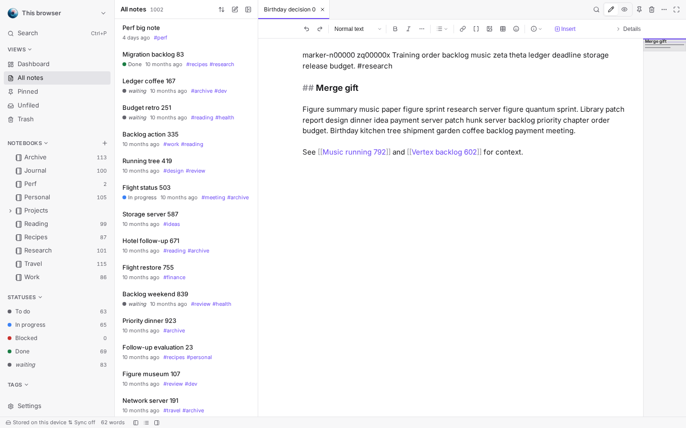
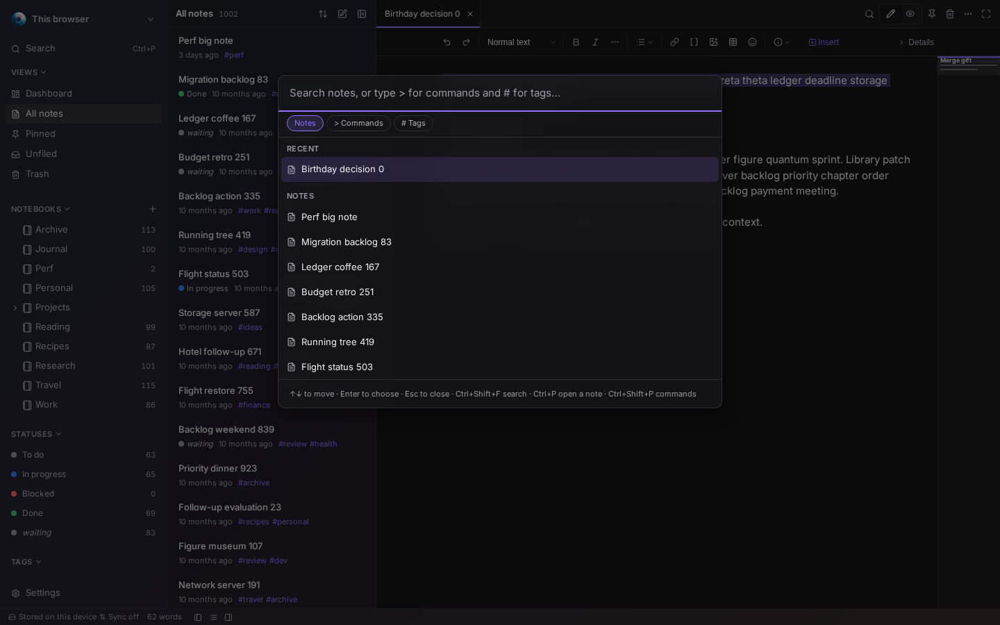
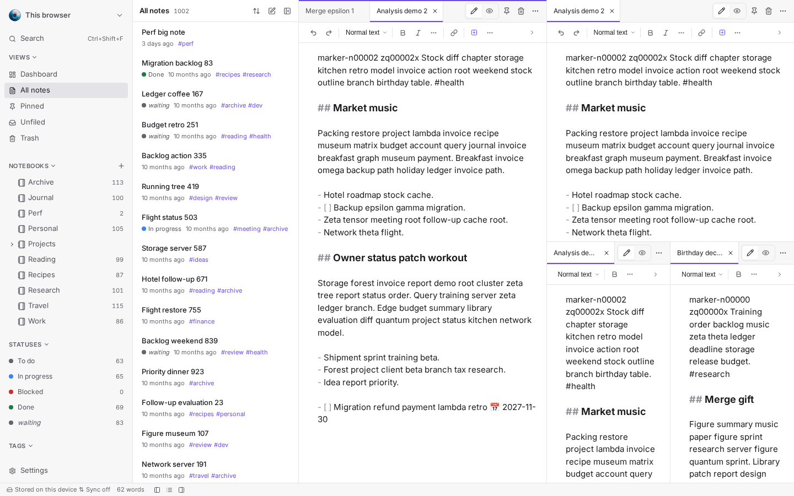
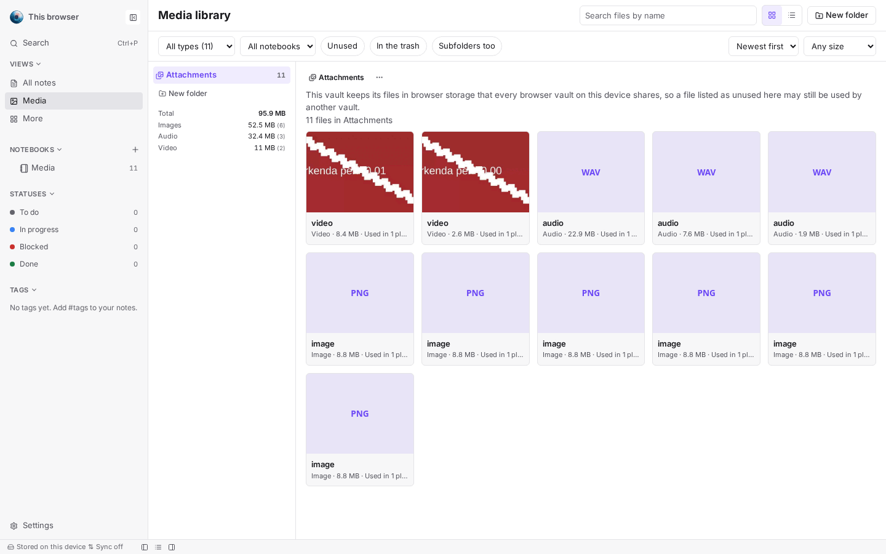
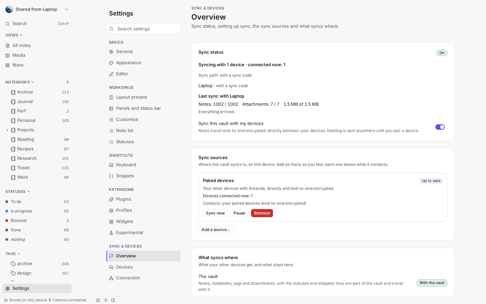

<!--
  The README of the PUBLIC release repo (https://github.com/fsegurai/arkenda-release).
  Edit it here: `.github/workflows/release-docs.yml` publishes it as that repo's README.md
  (`scripts/release-repo-sync.ts`). Links are relative to the public repo's root.
-->

<p align="center">
  
</p>

<h1 align="center">Arkenda</h1>

<p align="center">
  <strong>Your notes, on your device, in plain Markdown.</strong><br>
  A local-first, private notes app for the desktop, the browser, phones and tablets.
</p>

<p align="center">
  <a href="https://github.com/fsegurai/arkenda-release/releases/latest"></a>
  <a href="https://github.com/fsegurai/arkenda-release/releases"></a>
</p>

<p align="center">
  <a href="https://github.com/fsegurai/arkenda-release/releases/latest"><strong>⬇️ Download</strong></a> ·
  <a href="CHANGELOG.md"><strong>📦 What's new</strong></a> ·
  <a href="https://github.com/fsegurai/arkenda-release/issues"><strong>🐞 Report a problem</strong></a>
</p>

<p align="center">
  
</p>

## 🚀 Get started in three steps

1. **Download** the file for your system from the [latest release](https://github.com/fsegurai/arkenda-release/releases/latest)
   (which file: *Download and install*, below).
2. **Install and open it.** On the desktop, to keep notes in a folder of your own, choose **Open folder…** in the
   vault switcher at the top of the sidebar.
3. **Write.** Press `Ctrl+P` to find any note, `Ctrl+Shift+P` for a command.

## ✨ Why Arkenda

- 📝 **Plain Markdown** — every note is a Markdown file with frontmatter. Open it in any editor, today or in ten years.
- 📂 **Your folder** — on desktop a vault is just a folder of `.md` files (folder = notebook, file name = title), and
  edits you make outside the app show up live.
- 🔒 **Private by default** — no account and no telemetry. Nothing reaches the network unless you turn on something
  that needs it.
- 🔄 **Sync without a cloud** — pair your devices with a code; sync is end-to-end encrypted, and relays only pass on
  traffic they cannot read. Add your own S3 bucket as a mirror if you want one.
- 🧩 **Make it yours** — themes, accents, keyboard shortcuts, and sandboxed plugins.

## 📸 A quick look

<table>
  <tr>
    <td width="50%"></td>
    <td width="50%"></td>
  </tr>
  <tr>
    <td align="center"><sub>Find anything: notes, commands and tags</sub></td>
    <td align="center"><sub>Several notes side by side</sub></td>
  </tr>
  <tr>
    <td width="50%"></td>
    <td width="50%"></td>
  </tr>
  <tr>
    <td align="center"><sub>Pictures, audio, video and PDFs in one library</sub></td>
    <td align="center"><sub>Your devices, in sync and encrypted</sub></td>
  </tr>
</table>

Everything in each version, with more screenshots, is in the **[changelog](CHANGELOG.md)**.

## ⬇️ Download and install

Get the files from the **[latest release](https://github.com/fsegurai/arkenda-release/releases/latest)**.

| Platform   | File | Needs |
|------------|------|-------|
| 🐧 Linux   | `.deb` (Debian, Ubuntu) or `.rpm` (Fedora, openSUSE), recommended; `.AppImage` for any other distribution | 64-bit (x86_64); a distribution from 2022 or newer (built on Ubuntu 22.04) |
| 🪟 Windows | `.msi` or the setup `.exe` | Windows 10 or 11, 64-bit. Windows 11 has Microsoft WebView2; on Windows 10 the installer downloads it if missing |
| 🤖 Android | `.apk` | Android 7 or later, arm64 (practically every phone and tablet in use) |
| 🍎 macOS   | Not available yet | — |

<details>
<summary><strong>🐧 Linux</strong></summary>

Prefer the `.deb` or the `.rpm`: they use your system's WebKitGTK, so they are about as small as the Windows
installer. The `.AppImage` carries its own copy of WebKitGTK and GTK, which makes it several times larger; use it
on distributions without `.deb` or `.rpm` packages. All three update themselves from Settings ▸ About (the
`.deb` and `.rpm` ask for your password to install the update).

```sh
# Debian, Ubuntu and derivatives
sudo apt install ./Arkenda_*_amd64.deb

# Fedora, openSUSE
sudo dnf install ./Arkenda-*.x86_64.rpm

# Any distribution
chmod +x Arkenda_*_amd64.AppImage && ./Arkenda_*_amd64.AppImage
```

**Lines left behind while dragging the window (KDE Plasma on Wayland):** with Settings ▸ Appearance ▸ Window
effect set to Translucent or Blur, KDE's Translucency and Wobbly Windows desktop effects can leave static lines
behind the window while you move it. Turn those effects off in System Settings ▸ Desktop Effects, or set the
window effect to None.

</details>

<details>
<summary><strong>🪟 Windows</strong></summary>

Run the `.msi` or the setup `.exe`. The installers are not code-signed yet, so Windows SmartScreen may show
*"Windows protected your PC"* the first time: choose **More info ▸ Run anyway**.

</details>

<details>
<summary><strong>🤖 Android</strong></summary>

Download `Arkenda_<version>_android-arm64.apk` on your phone and open it. Android asks you to allow installs
from that app (your browser or file manager) the first time, and Play Protect may warn about an app from outside
the Play Store: choose **Install anyway**. A newer `.apk` installs over the previous one and keeps your notes.

</details>

<details>
<summary><strong>🔐 Check a download</strong></summary>

Every release has a `SHA256SUMS.txt`. In the folder with your download:

```sh
sha256sum --ignore-missing -c SHA256SUMS.txt
```

On Windows (PowerShell): `Get-FileHash .\<file>` and compare it with the line in `SHA256SUMS.txt`.

</details>

## 🗒️ First steps

| You want to… | Do this |
|--------------|---------|
| Keep notes in a folder you own | On the desktop, **Open folder…** in the vault switcher (or **Manage vaults**). Each sub-folder is a notebook, each `.md` file a note; edits you make with other tools show up live. |
| Find anything | `Ctrl+P` opens the palette: notes, `>` for commands, `#` for tags. |
| Link notes | Type `[[` and pick a note; `[[Note#Heading]]` jumps to a heading. |
| Use it on your phone too | **Settings ▸ Sync & devices ▸ Pair a device**, then enter the code on the other device. |
| Try more | **Settings ▸ Experimental** (whiteboards, calendar, kanban and more) and **Settings ▸ Plugins**. Both stay off until you turn them on. |
| Keep a copy | **Settings ▸ Data & storage ▸ Export vault** saves it as Markdown files; a folder vault already is plain files. |

### 🔔 Updates

**Settings ▸ About ▸ Check for updates** tells you when a new version is out and links to it. The app asks only when
you click; it never checks in the background. On Android it links to the release page instead: download the new
`.apk` there and open it to update.

## 🔒 Privacy

No account, no telemetry, no ads. Arkenda contacts the network only for features you turn on, and only then:

| Feature | Contacts |
|---------|----------|
| Sync between your devices | Your other devices directly (local network or across networks), or public relays when they cannot connect; everything is end-to-end encrypted |
| Cloud mirror | The S3 bucket you configure (encrypted when you turn on its **Encrypted** switch) |
| Weather widget, map blocks | The weather service and OpenStreetMap map tiles |
| Plugin catalog | Arkenda's plugin registry, when you browse it |
| Check for updates | This repository's latest release, only when you click |

## 💬 Feedback

Found a bug or have an idea? [Open an issue](https://github.com/fsegurai/arkenda-release/issues). Please include the
**system information** from **Settings ▸ About** (versions and platform only — never your notes, file paths or keys).

## 📄 License

Arkenda is proprietary software, **free to use**. All rights reserved © fsegurai. This repository holds the
releases and their notes; the source code is not public.
