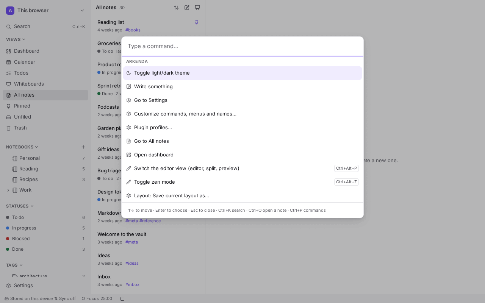
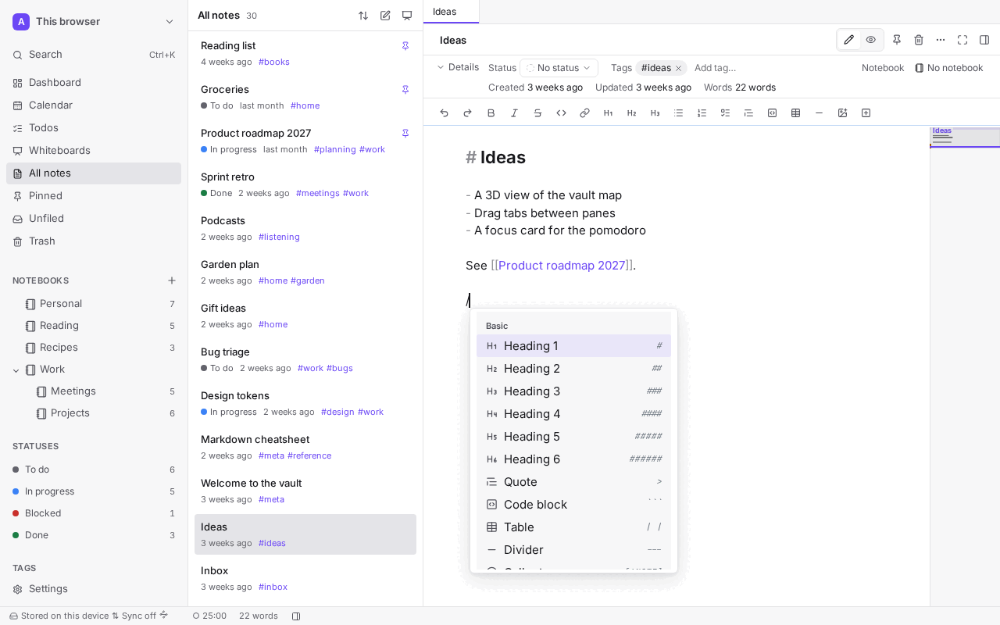
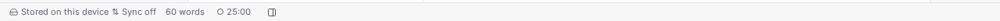
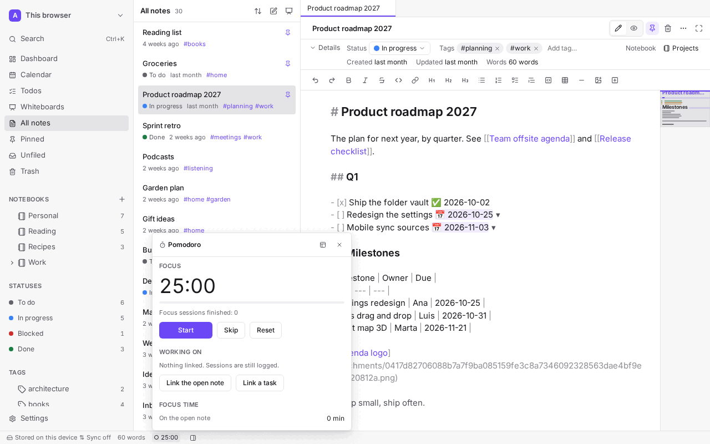
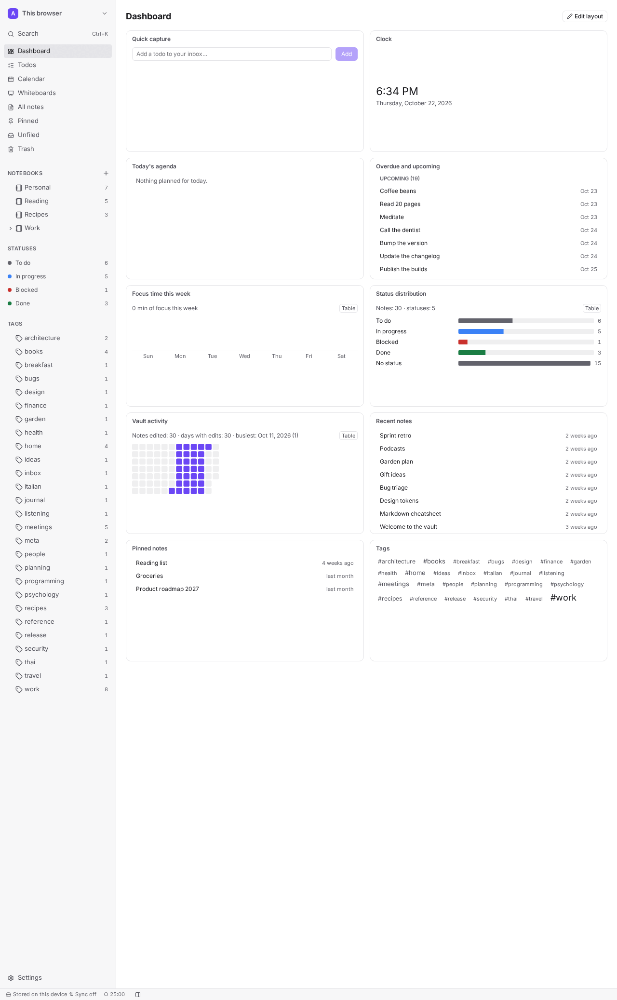
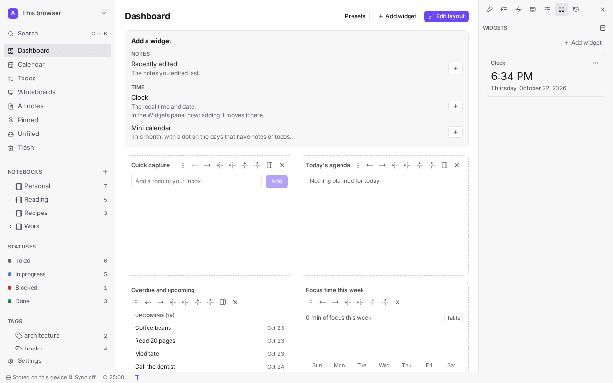
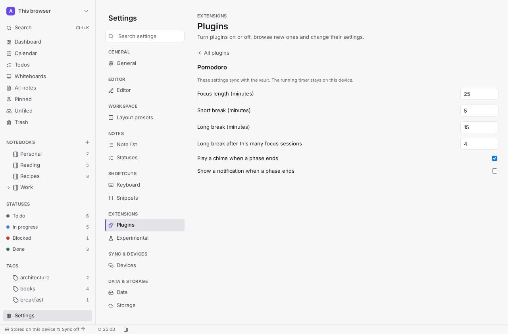

# Surfaces

Where a plugin can show, and when to use each place. Declare every item in `contributes` first:
the app shows titles from there before any code runs, and refuses an undeclared id (`not-declared`).

| Contribution kind | Shows as | Call | Permission |
|-------------------|----------|------|------------|
| `commands` | A command in the palette, with an optional default hotkey | `commands.register` | `commands` |
| `insertItems` | A block in every insert menu of the editor | `editor.registerInsertItem` | `editor` |
| `toolbarItems` | A button on the editor toolbar | `editor.registerToolbarItem` | `editor` |
| `sidebarPanels` | A tool: a sidebar panel, or a chip in the status bar | `views.registerSidebarPanel` | `ui:panels` |
| `dashboardWidgets` | A widget on the dashboard or in the Widgets panel | `dashboard.registerWidget` | `ui:widgets` |
| `settingsTabs` | A tab of its own in its settings page | `settings.registerTab` | `ui:panels` |
| `markdownFeatures` | A fenced code block language it renders | `markdown.registerCodeBlock` | `markdown` |
| `themes` | A theme in the app's theme picker | `appearance.registerTheme` | `ui:themes` |
| `syncSources` | A sync source in Settings ▸ Sync & devices (`syncing` category, API 1.1) | `sync.registerSource` | `sync` |

Users can rename your commands, toolbar buttons, panels and widgets, and hide or reorder commands
(Settings ▸ Customize). They find them by id, so **keep ids stable across versions**, and never rely
on your own title being shown.

## Commands

Use a command for anything a person may want from the keyboard. Its title and default hotkey come
from `contributes.commands`; the hotkey (`Mod-Shift-k`) is shown for approval when the plugin is
reviewed and bound only when free (the app's and the user's keys win; reserved keys never bind).



## Insert items and toolbar items

Use an insert item for a block people add while writing; a toolbar item for a frequent action on
the editor toolbar. Both are data, checked when registered:

- `text`: the Markdown it inserts, up to 4 KB; `cursor`: where the caret goes (its end by default).
- `icon`: one of `PLUGIN_EDITOR_ICONS`; anything else is refused.
- Insert items only: `group` (one of `PLUGIN_INSERT_GROUPS`, `plugins` by default), up to 8
  `keywords` the menus' filter matches, and a `detail` (up to 120 characters) shown in the `/` menu.
- A toolbar item either inserts `text` or runs one of your `command`s.

```ts
await ctx.editor.registerInsertItem({
  id: 'meeting', text: '## Meeting\n\n- ', icon: 'format-calendar', group: 'basic', keywords: ['agenda'],
});
```



## Tools: sidebar panels and status chips

Use a panel for something people keep open next to their note. A panel is a *tool*, and a tool shows
in one place at a time: the left sidebar, the right sidebar or the status bar. In the status bar it is
a chip whose click opens the same view in a popover (a bottom sheet on phones).

- `places`: distinct values among `left`, `right` and `status`; both sidebars without it.
- `defaultPlace`: one of `places`; `left` (else its first place) without it.
- `icon`: one of `PLUGIN_PANEL_ICONS`, for its tab.

The person moves a tool among its places, from its menu or in Settings ▸ Workspace ▸ Panels and
status bar; their choice wins. On the desktop, a tool that allows `status` can also go to Arkenda's
title bar: a host place you never declare.

```json
"sidebarPanels": [{ "id": "timer", "title": "Timer", "places": ["right", "status"], "defaultPlace": "status" }]
```




## Widgets

Use a widget for a glanceable summary. It lives on the dashboard or in the Widgets panel (`aside`).

- `category`: one of `notes`, `tasks`, `time`, `focus`, `insights`, `other` (the default); the
  pickers group widgets by it.
- `places`: distinct values among `dashboard` and `aside`; the dashboard only without it.
- `defaultPlace`: one of `places`; `dashboard` (else its first place) without it.
- `defaultSize` and `minSize` (`{ w, h }`) at registration.




Panels, widgets and settings tabs show a `SandboxView`: headings, text (`muted` or `strong`), lists,
links to notes and tags, and buttons that call your `onAction`. Limits are in
[The sandbox](sandbox.md#limits).

```ts
{ blocks: [
  { kind: 'heading', text: 'Today' },
  { kind: 'text', text: '3 notes', tone: 'muted' },
  { kind: 'list', items: [{ kind: 'note', noteId: 'n1', label: 'Plan' }, { kind: 'tag', tag: 'work' }] },
  { kind: 'button', label: 'Refresh', action: 'refresh' },
] }
```

## Settings tabs

Use the declarative [settings](settings.md) first; add a tab only for something fields cannot
express (a status, a list of results).



## Markdown code blocks

`markdown.registerCodeBlock({ id, render })` renders fenced blocks whose language is a declared
`markdownFeatures` id (```` ```reading-time ````). `render(source)` returns HTML; the app sanitizes
it (no scripts, styles, frames, forms, event handlers or unsafe URLs) and hardens it like a note.
When rendering fails, the code block stays.

## Themes

A theme is token values only (`THEME_TOKENS`: colours, quoted font stacks, radii, line heights),
with an optional dark set. Anything outside the token grammar, or text below 4.5:1 contrast on the
background, is refused. The `theme` [extension kind](manifest.md#extension-kinds) will carry themes
without code; until it installs, a theme ships inside a plugin.

## Sync sources

From API 1.1 (`ctx.apiMinor >= 1`), a plugin of the `syncing` [category](manifest.md#taxonomy) with the
`sync` [permission](permissions.md) can offer a way to sync a vault (a server, a service, a protocol).
Declare it in `contributes.syncSources` (its title is the name people see), then register it
(`ctx.sync` exists only when the manifest declares `sync`; the grant is checked at every call):

```js
const source = await ctx.sync?.registerSource({
  id: 'my-server',
  needs: ['account'],
  async onControl(action) {
    if (action === 'start' || action === 'sync') await pushAndPull();
    if (action === 'stop') cancelPass();
    if (action === 'remove') await ctx.storage.delete('cursor');
  },
});
await source?.setStatus({ state: 'idle', lastSyncAt: Date.now() });
```

- **The user decides.** People add the source per vault in Settings ▸ Sync & devices, see its status
  and what it contacts, and pause or remove it there. The app calls `onControl` with `start` (added,
  or the app started with it added), `stop` (paused or taken out), `sync` (one pass now: "Sync now",
  or the app opened or came back to the foreground) and `remove` (forget what you kept for that vault).
- **Nothing in the background on phones.** Sync on `start` and `sync` only; keep no timers of your own.
- **No access of its own.** A source reads and changes notes only through `notes` (and the notebook
  or tag scope the user chose), and reaches only the `network.hosts` the user approved, which the app
  lists as what the source contacts. Registering a source grants nothing.
- **Revocation is immediate.** While `sync` is revoked, the app sends no control call and refuses
  `setStatus`; revoking `network` or `notes:*` refuses those calls at once as usual.
- `setStatus` takes `idle`, `syncing` or `error`, a line of at most 160 characters (`detail`) and
  `lastSyncAt`; `paused` and "not available here" are the app's.

## Not available to plugins yet

- **Built-in plugins only:** note actions, status bar items of their own, history providers, and
  CodeMirror or Marked extensions.
- **No plugin API yet:** sidebar views and map node kinds.
