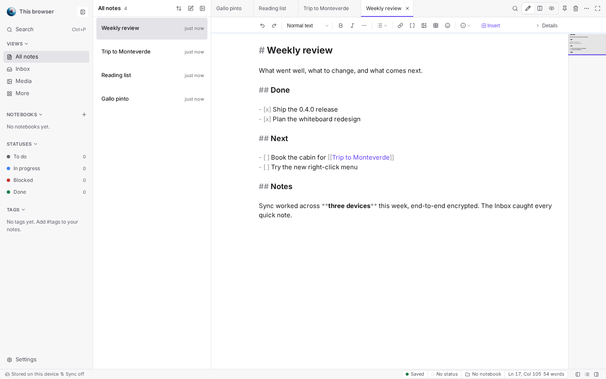
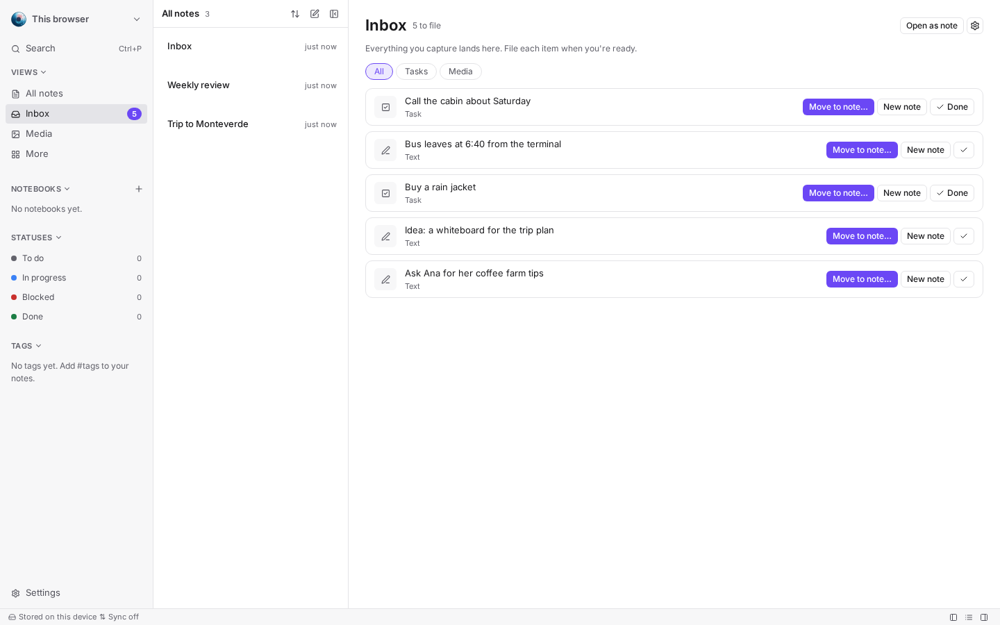
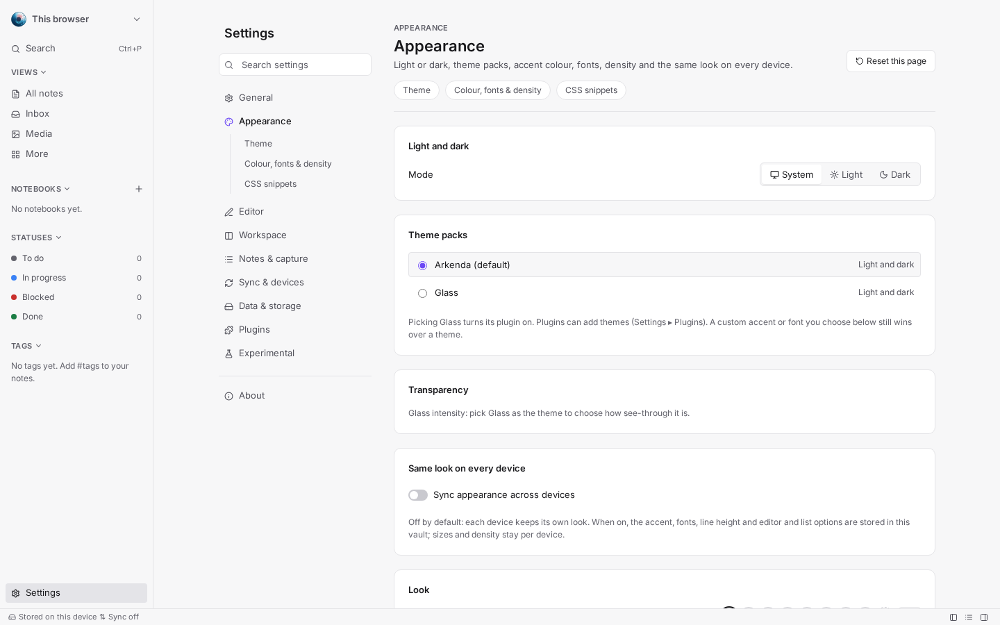
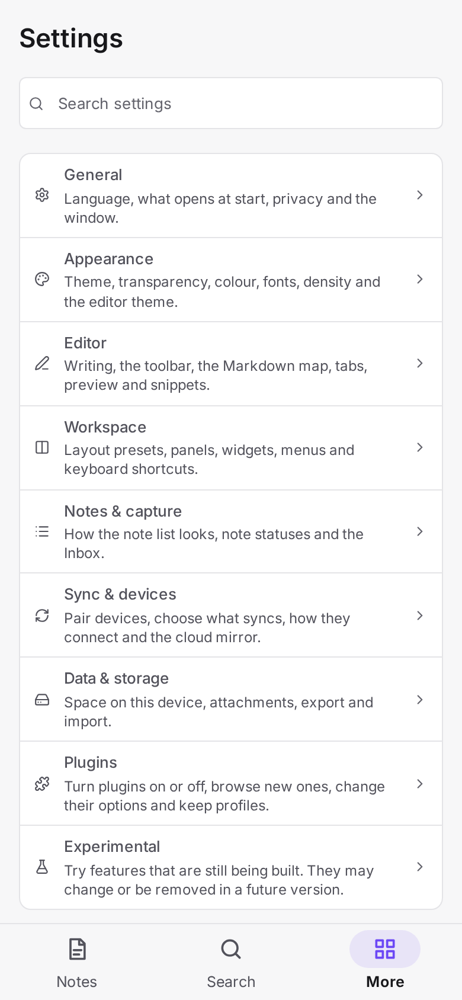
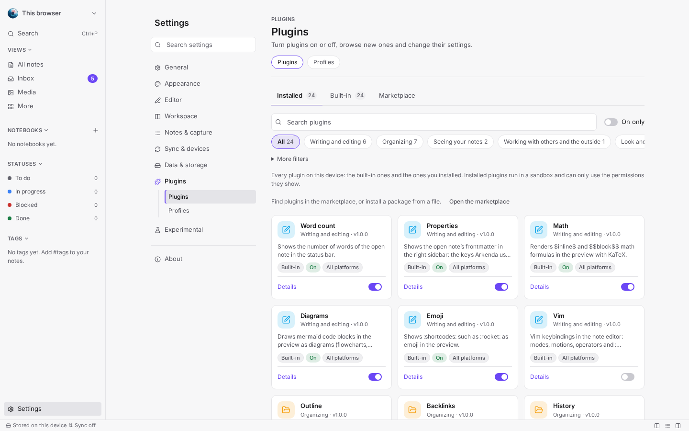
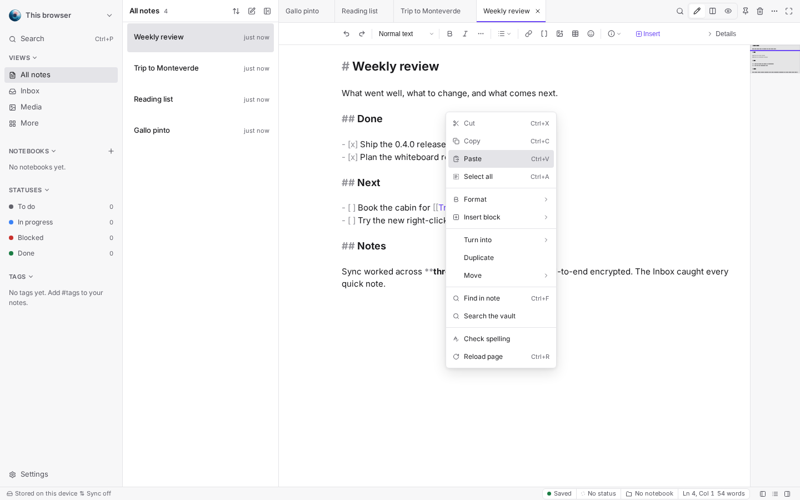
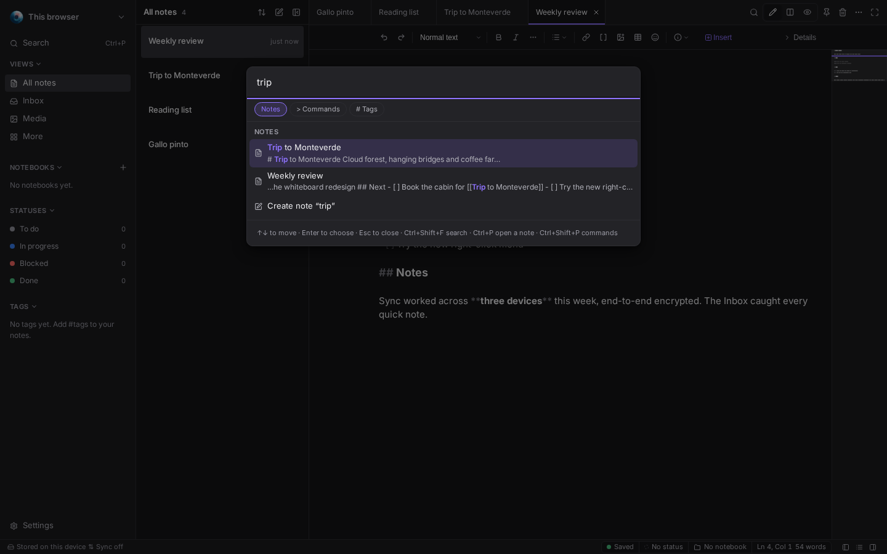

# What's new in 0.4.0

Released on 2026-11-11.

A redesigned Settings, an Inbox that files your captures, a richer right-click menu with spelling suggestions,
a cleaner Markdown map, Arkenda in the Microsoft Store, and phones that save battery when Arkenda is in the
background.

  

### ✨ New

- **Inbox** — one Inbox note per vault, with its own page to file what you capture: move a line to a note, turn it
  into a new note, or mark it done. Images, videos and files show what they are, with their name and a thumbnail.
  Choose the Inbox note and what filing does in **Settings ▸ Notes & capture ▸ Capture**.

  

- **Redesigned Settings** — every option grouped into nine categories, with the less common ones folded under
  **Advanced**, one search that also finds plugins and experiments, an icon rail on tablets and category screens
  on phones.
- **Plugins and Experimental as grids** — filter by family or area, search, show only what is on, and open a
  plugin's options in a sheet.

  <table>
    <tr>
      <td width="62%"></td>
      <td width="38%" align="center"></td>
    </tr>
    <tr>
      <td align="center">The categories and one search on the desktop</td>
      <td align="center">One screen per category on phones</td>
    </tr>
    <tr>
      <td colspan="2"></td>
    </tr>
    <tr>
      <td colspan="2" align="center">Plugins as a grid: families, search and On only</td>
    </tr>
  </table>
- **Media library preview** — each file previews by its kind: images whole, video and audio that play in place
  (audio with its waveform), a PDF's first page and page count, a text file's first lines.
- 🧪 **Right-click menu** — back and forward, reload (it saves your edits first), zoom, settings, and in the editor
  **Check spelling**; 🖥️ on Linux and Windows the misspelled word's suggestions appear at the top of the menu. On by
  default; turn it off in **Settings ▸ Experimental**.

  <table>
    <tr>
      <td width="50%"></td>
      <td width="50%"></td>
    </tr>
    <tr>
      <td align="center">The editor's right-click menu</td>
      <td align="center">Ctrl+P finds notes, commands and tags</td>
    </tr>
  </table>
- **Ctrl+Tab order** — in **Settings ▸ Editor ▸ Tabs**, keep the strip order (Linear) or switch to the most recent
  tabs (Recent): hold Ctrl and press Tab to walk back, release to land.
- **Keys** — Alt+← / Alt+→ go back and forward, Ctrl+R (⌘R) reloads after saving.
- 🖥️ **Microsoft Store** — Arkenda can be installed from the Microsoft Store, signed by Microsoft and updated by
  the Store. The direct installers stay available as before.
- 📱 **Save battery** — when Arkenda goes to the background on a phone, sync pauses and catches up as soon as you
  return. Turn it off in **Settings ▸ Sync & devices ▸ Connection ▸ Battery** to keep syncing in the background.

### 🔧 Changes

- **Markdown map** — shows your note's text from far away, one stroke per word, instead of a small blurry render;
  the heading under the pointer shows as a tip.
- **Glass theme** — picking Glass turns it on in one step; choose **Subtle** or **Strong** (today's look), and find
  Reduce transparency and the window blur together under **Transparency**.
- 🖥️ **Window effect** — the **Translucent** mode was removed (a see-through window looked bad on Linux and
  Windows); **Blur** stays as it was. A device that used Translucent now opens with the effect off.
- 📱 **Phone settings** — phones no longer show settings that don't apply to them (toolbar, tabs, reading width,
  layout presets, panels and widgets).
- **Inline code** stands out from the text, in the editor and the preview.
- **Video cards in lists** — a YouTube or X link alone in a list item now shows as a card too.
- **Sync messages** — clearer reasons when a device can't be reached, and which backups each device has.
- 🖥️ **Windows installers** show Arkenda's icon and branding.

### 🐛 Fixes

- 🖥️ **YouTube cards on desktop** — videos play instead of showing "Error 153".
- **Pasting screenshots** — images copied from a screenshot tool paste into the editor.
- **Pinned notes** — pinning from the editor always shows in the note list (folder vaults).
- 🖥️ **Title bar** — the app no longer slides up behind Arkenda's title bar.
- 🖥️ **Middle-click on a tab** (Linux) — closes the tab without pasting into the note.
- **Reduce transparency** shows only where it applies.
- 📱 **Phone screens** — the image viewer and annotator clear the status bar, and links open in your browser.
- **Search after a hiccup** — if search's background helper restarts and your notes can't be read right away,
  search keeps retrying in the background and catches up without waiting for you to edit a note.

### ⚡ Performance

- **Less memory in large vaults** — each note's searchable text is kept once instead of twice (about 20% less
  memory with 10,000 notes), and the editor remembers the cursor and scroll position of up to 200 notes per pane.
- 🖥️ **Faster desktop start** — less code loads before the window appears.

### 📝 Documentation

- A privacy policy and issue forms for bugs, features, questions and other feedback.
- The README shows the 0.4.0 screens and features: the Inbox, tabs, the Glass theme, the new Settings
  paths and in-app updates.

---
