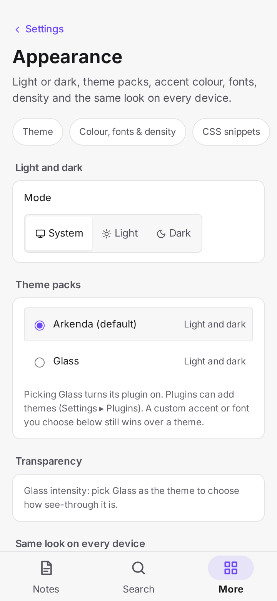
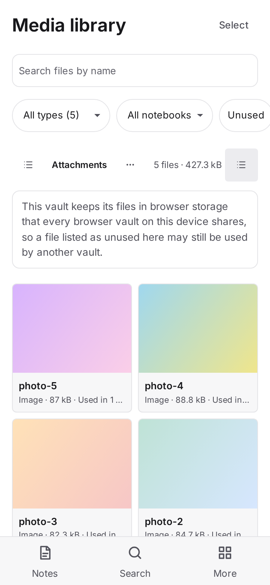
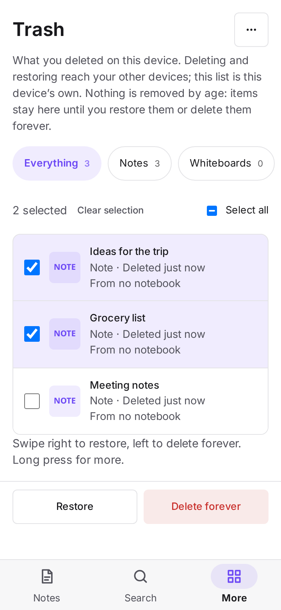

# What's new in 0.4.1

Released on 2026-11-12.

Roomier, tidier pages on phones, pasting that works again in the Linux app, videos that play in the Linux
AppImage, and a trash that really deletes on phones.

<table>
  <tr>
    <td width="33%" align="center"></td>
    <td width="33%" align="center"></td>
    <td width="33%" align="center"></td>
  </tr>
  <tr>
    <td align="center">Settings</td>
    <td align="center">Media library</td>
    <td align="center">Trash</td>
  </tr>
</table>

### 🔧 Changes

- 📱 **Phone pages** — Settings, the media library, the trash, More, Today, Inbox, Todos, Calendar, Dashboard,
  Board, Whiteboards and Vaults share one layout on phones: the same margins, the title with at most one button
  beside it, tabs and filters in one row you swipe sideways, and each card's title above the card. Computers and
  tablets look as before.
- 📱 **Trash** — **Empty trash** is in the **⋯** menu at the top; with items selected, **Restore** and
  **Delete forever** stay at the bottom of the screen.
- 📱 **Settings** — **Reset this page** is at the end of the page.
- 📱 **Inbox** opens as its own page on phones instead of the note list.

### 🐛 Fixes

- 🖥️ **Paste on Linux** — the right-click menu's **Paste**, and pasting a screenshot with Ctrl+V, work again in the
  Linux app ("The app is not allowed to read the clipboard" is gone).
- 🖥️ **Videos in the Linux AppImage** — adding a large video no longer freezes the AppImage or turns its window
  black, and YouTube cards play; the AppImage now carries the media plugins it needs on every distribution.
- 📱 **Delete forever on phones** — **Empty trash** and **Delete forever** no longer bring deleted files back into
  the media library. On a phone or in a browser, a file other vaults on the device may share stays stored, but it no
  longer shows in the library unless a note uses it again.

---
