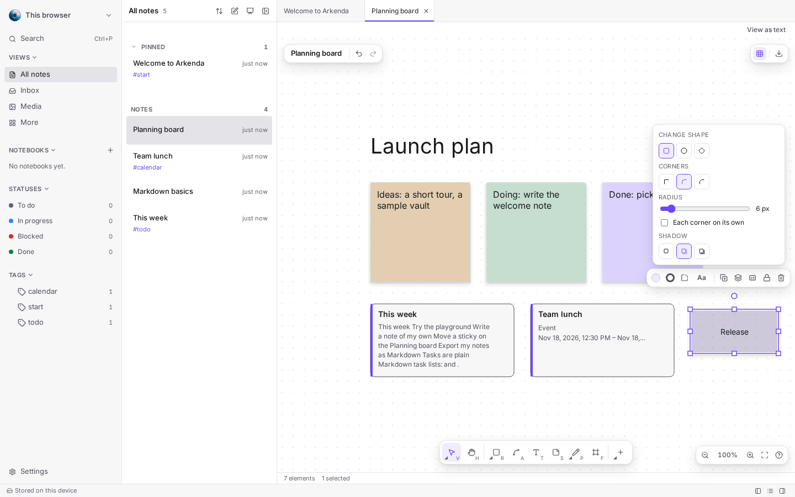
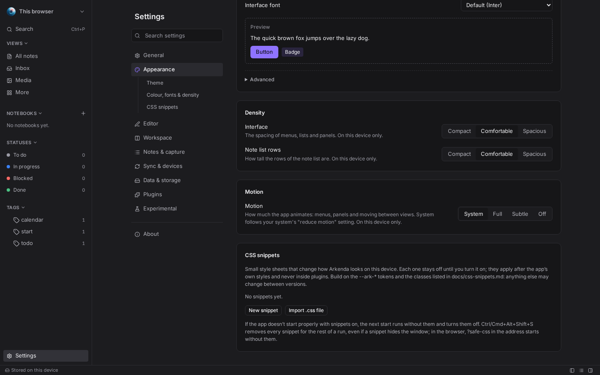
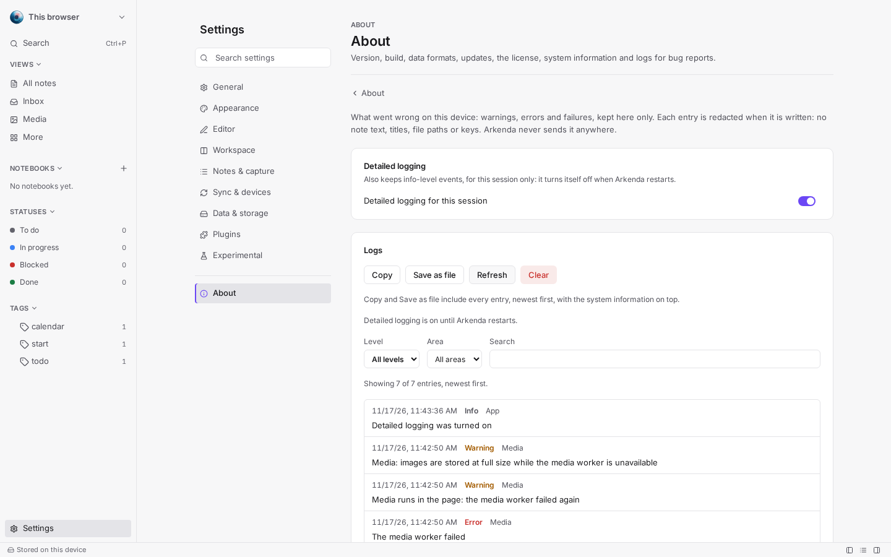
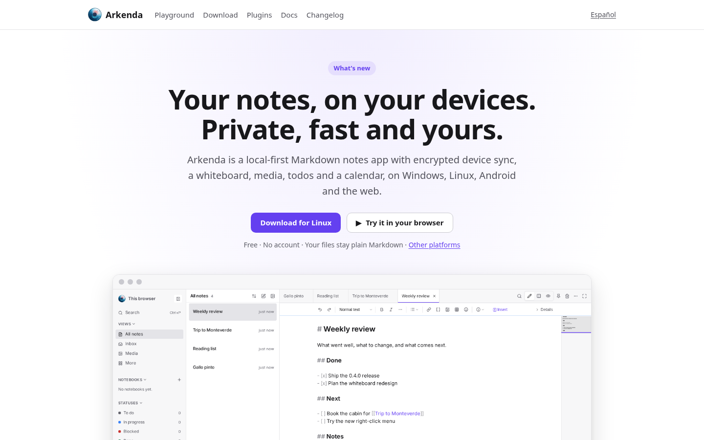
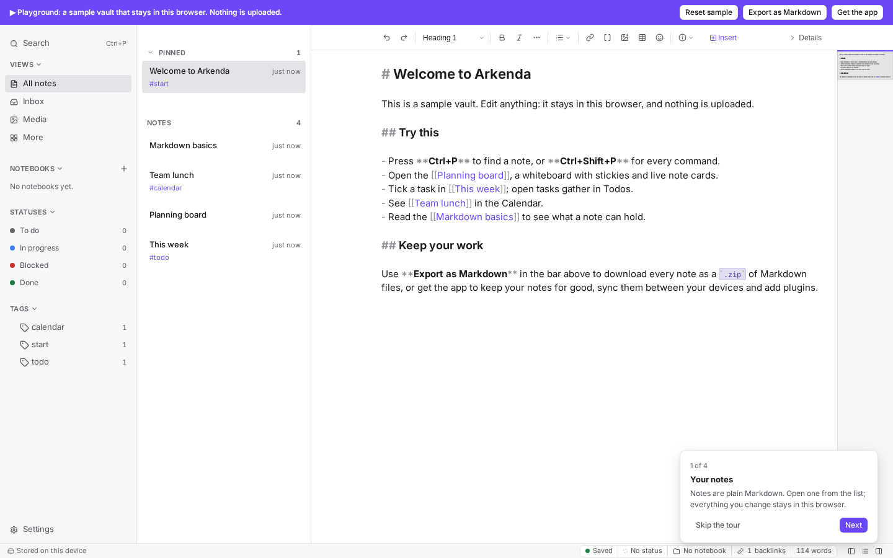
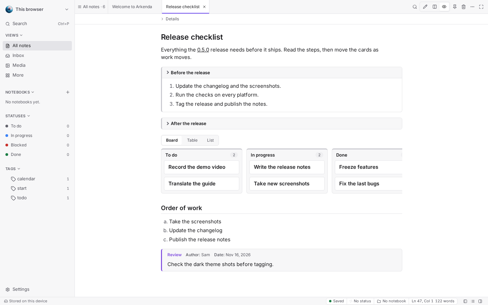
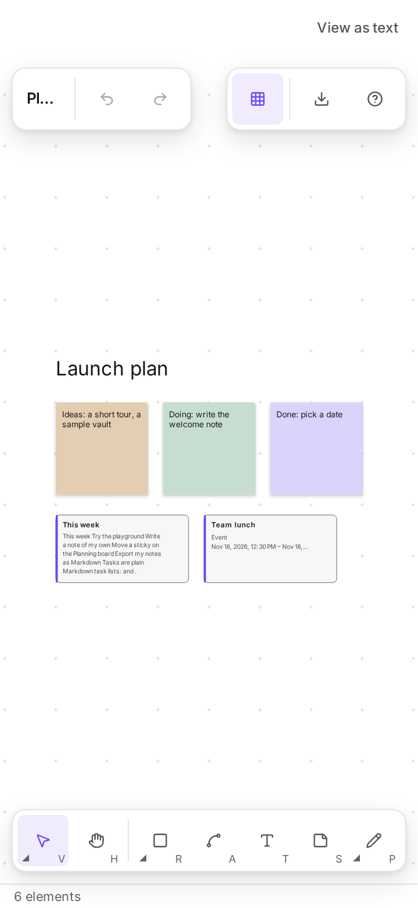
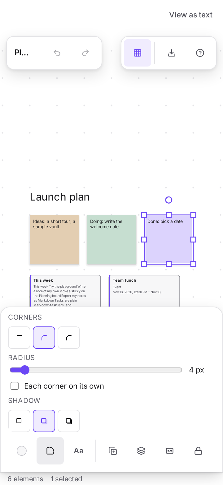

# What's new in 0.5.0

Released on 2026-11-17.

Dictation that stays on your device, a website with a playground to try Arkenda in the browser, motion you can
tune or turn off, a sharper Linux app (Wayland quick capture, an AUR package, native contrast and motion), logs you
can share, a fuller whiteboard, and a public guide for plugin authors.

  

### ✨ New

- 🖥️🧪 **Quick capture from any app on Wayland** — on KDE Plasma, GNOME and other Wayland desktops whose portal offers
  global shortcuts, quick capture's key now works whatever app has the focus: the desktop asks you to confirm the key
  in its own dialog the first time, and Settings ▸ Keyboard shows the key it bound (it may differ from yours).
  Desktops without that portal keep the X11 key, which works only while an X11 app has the focus, and Settings says so.
- 🖥️ **Arch Linux package** — install Arkenda on Arch and its derivatives from the AUR (`yay -S arkenda-bin`). It
  uses your system's WebKitGTK, video codecs and GTK theme instead of the AppImage's own copies, and pacman keeps it
  up to date (Settings ▸ About says so instead of offering an in-app update).
- 🖥️ **Linux rendering fallback** — for blank or flickering windows on some GPUs: Settings ▸ Experimental ▸ Linux
  rendering fallback starts Arkenda without DMA-BUF or without compositing, after a restart. On NVIDIA systems Arkenda
  now adds `__NV_DISABLE_EXPLICIT_SYNC=1` at start; a variable you set yourself always wins. Programs Arkenda starts
  (the terminal, git, your browser and players) keep your own environment. If a start never reaches the window, the
  next one goes back to Auto and says so; `ARKENDA_RENDERING=auto` forces Auto for one launch.
- **License** — Arkenda's terms are now written down in LICENSE: free to use on any number of devices,
  personal or commercial; share the official, unmodified release files; no selling or modified copies. The Linux
  packages carry it too.
- **Motion setting** — Settings ▸ Appearance ▸ Motion: System (full motion, or none when your system asks to reduce
  motion; it follows a change at once), Full, Subtle or Off, on this device only. The app's animations follow
  it.

  

- **Small feedback** — buttons give a little when pressed, switches slide, checkboxes and radios dip while pressed,
  and button and menu highlights fade in; all of it follows the Motion setting (none at Off), and keyboard focus
  still shows at once. Checkboxes, sliders and progress bars use the accent colour everywhere, and the settings pages
  use the app's standard buttons.
- 🖥️ **System contrast and reduced motion on Linux** — the desktop app now reads high contrast and reduce motion from
  your desktop's settings (GNOME, KDE and others through the settings portal), even where the webview misses them, and
  follows a change at once: high contrast strengthens borders and muted text, and the System motion level turns
  animations off. In every app, high contrast now also applies in the dark theme.
- **Logs you can share** — Settings ▸ About ▸ Logs keeps the warnings and errors of this device (the app, its
  workers and the desktop and Android shells), at most about 1 MB, redacted when written: no note text, titles, file
  paths or keys, and nothing is ever sent. Filter by level and area, search, Copy, Save as file (a `.txt` with the
  system information on top) or Clear. Detailed logging adds info-level events until Arkenda restarts. Report a
  problem says how to attach the saved file. On Android, Share hands the same file to an app you pick (mail, chat, a
  drive) through the system's share sheet.

  

- 📱 **Dictation** — the microphone button in the editor's toolbar (or Dictate in the command palette) types what
  you say at the cursor: the words heard so far show as you speak, and each finished phrase is one undo step. Press
  it again or Escape to stop. It uses only a recognizer that runs on your device, so no audio ever leaves it: on
  Android 12 and later (the system's on-device recognizer; a missing language model can be downloaded first), and in
  Chrome on a computer that has one. Where there is none (Linux, Firefox, Windows for now) the button does not show;
  on Windows, Win+H still types into the editor.
- **Website and playground** — Arkenda has a website at https://fsegurai.github.io/arkenda-release/ (English and
  Spanish): what it does, downloads for your system from the latest release, the user guides, the plugin guide, the
  changelog and the privacy policy. Its **playground** runs the web app with a sample vault in your browser, kept apart
  from any vault of yours, with nothing sent anywhere (sync, the marketplace, link previews and weather say "App
  only"); Reset sample and Export as Markdown are in its banner.

  <table>
    <tr>
      <td width="50%"></td>
      <td width="50%"></td>
    </tr>
    <tr>
      <td align="center">The website, in English and Spanish</td>
      <td align="center">The playground, with a sample vault and a short tour</td>
    </tr>
  </table>
- **Plugin guide for authors** — the guide for writing plugins is public, with new pages on what a plugin must have,
  its limits, what to consider (privacy, performance, accessibility, phones, sync) and how submitting works. Publishing
  plugins to other users is not open yet; the new "Plugin submission" form registers a plugin and asks for an early
  look.
- 🧪 **More Markdown blocks** — new experiments in Settings ▸ Experimental, off until you turn them on: **accordions**,
  **kanban blocks** (shown as a board, read only), **slides** (a presentation block with an overview and full screen),
  **comments** (review comments with replies, as a block or inline), **lettered and Roman lists**, and
  **inserted, superscript and subscript text** (++ins++, x^2^, H~2~O).

  

### 🔧 Changes

- 🧪 **Whiteboard: floating tools** — the bar above the board gives way to chrome that floats over it: a tool dock at
  the bottom (shapes and insert in flyouts; the dock shows the last shape you picked, on this device), the board's
  title with undo and redo at the top left, export at the top right, and zoom at the bottom right. Every tool keeps its
  key, shown in its button's corner, and **?** lists every key of the board. 📱 On a phone the dock scrolls sideways, the selection's style opens as a sheet from
  the bottom, the **?** button sits at the top right, and you zoom by pinching.

  <table>
    <tr>
      <td width="50%" align="center"></td>
      <td width="50%" align="center"></td>
    </tr>
    <tr>
      <td align="center">The tool dock on a phone</td>
      <td align="center">The selection's style as a sheet</td>
    </tr>
  </table>
- 🧪 **Whiteboard: property bar** — the selection's style opens in a bar above it (a sheet from the bottom on a 📱
  phone) instead of the side panel: fill and stroke from the palette or any custom colour, stroke width and **dash
  style** (solid, dashed, dotted), opacity, and for text the **font** (app font, serif, monospace, handwritten, or a
  font installed on the device), **size** (S, M, L, XL or any size in px), **bold, italic, underline,
  strikethrough**, **colour**, **outline** (colour and width), **alignment** (left, centre, right, justify; top,
  middle, bottom) and **text opacity**. **Lock** (Ctrl+Shift+L) keeps elements from being moved, resized, restyled or
  deleted until unlocked. Boards stay readable by 0.3.0 and 0.4.0, which keep the new styles as they are.
- 🧪 **Whiteboard: shape options** — the property bar's shape section **changes a shape** into another (rectangle,
  ellipse, diamond) keeping its text, style and place; sets the **corners** of a rectangle, diamond, sticky note or
  frame: sharp, round with a radius, cut, or **each corner on its own**; and adds a **shadow** (soft or hard) to a
  shape, sticky note or frame. The SVG and PNG exports draw them. 0.3.0 and 0.4.0 keep these styles as they are and
  draw a rectangle's radius (cut corners show round there). A changed shape keeps its corners as they looked, its
  connectors, its frame and its group.
- 🧪 **Whiteboard: editing** — **duplicate** (Ctrl+D, or Alt-drag; connectors between the copies stay connected),
  **align and distribute** in the property bar once two or more are selected (a group moves as one), **arrange**
  (bring to front, bring forward, send backward, send to back) in the property bar and the right-click menu, **copy
  and paste style** (Ctrl+Alt+C and Ctrl+Alt+V), and **right-click menus** for elements and for the board. A
  **grid** (dots, lines or off: G or the top-right button) follows pan and zoom, and moves and resizes can **snap to
  it** (from the board's menu; hold Ctrl or ⌘ to move freely); it is kept per device and never exported. The
  **lasso** (Q, in the select tool's flyout) selects what you draw around.
- 🧪 **Whiteboard: eraser** — the **eraser** (E, in the pens flyout beside the pen) erases what you drag over: the part
  of a pen line it crosses (a line crossed in the middle becomes two; hold Shift to erase the whole line) and whole
  shapes, texts, stickies and connectors. Locked elements stay, a drag is one undo step, and what will go is dimmed
  while you drag. 📱 Works with a finger too. Boards stay readable by 0.3.0 and 0.4.0: the two halves of a line are two
  ordinary pen lines.

- **Motion: menus, dialogs and moving between views** — menus, dialogs, the command palette, toasts and sheets now
  fade and scale in and out, a new view fades in and rises a little, a tab widens as it opens and narrows as it
  closes, and the sidebar slides when you collapse or expand it. All of it follows Settings ▸ Appearance ▸ Motion:
  shorter at Subtle, and none at Off (or when your system asks to reduce motion with Motion on System).
- **Markdown rendering** — the preview's Markdown extensions moved to their new version: alerts take their titles in
  the app's language, and the table of contents and ==highlights== look as before. Exported pages may need their
  stored CSS updated for the renamed task-box and table-of-contents classes.
- **Plugin checks** — every plugin input (manifest, settings, package, sandbox messages) is now checked by one set of
  rules, and the install dialog names each problem with its message (`path: message [code]`) instead of a code only.
  The manifest schema in the plugin guide is generated from the same rules.

---
